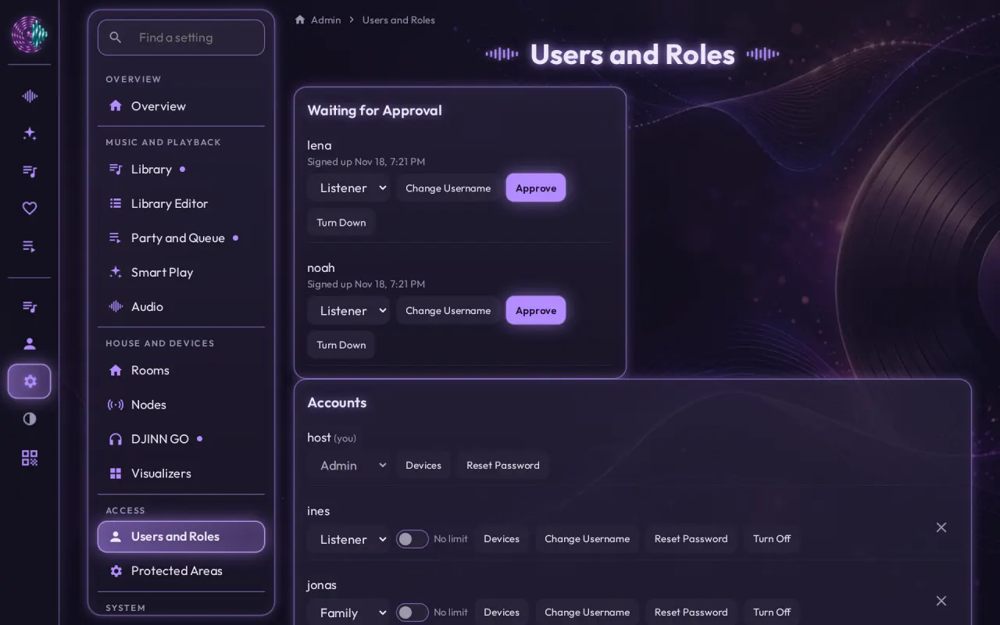
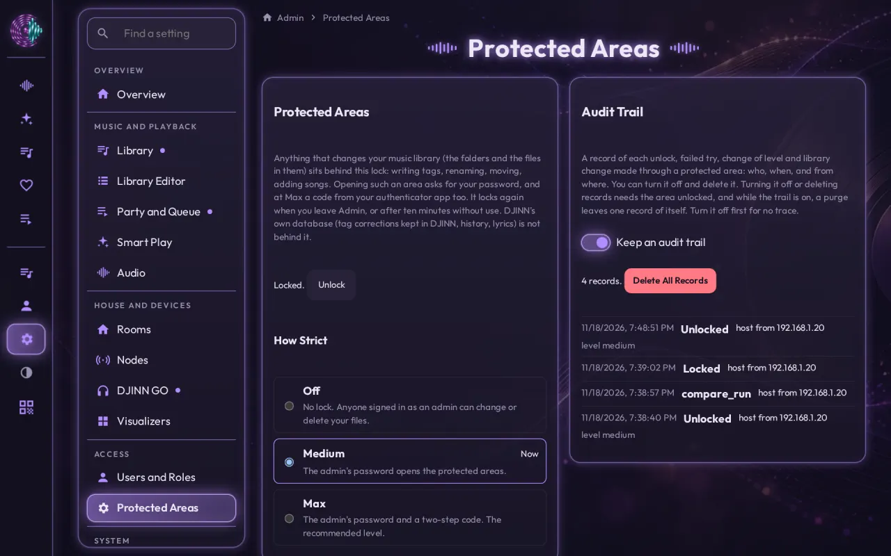
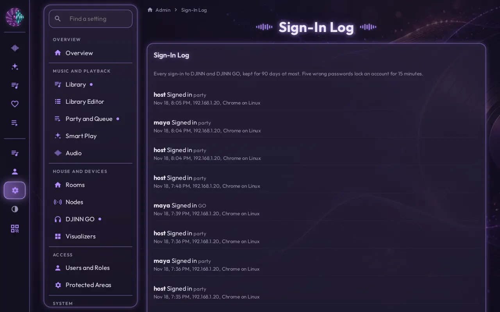

# Accounts and roles

Everything here is under **Admin > Users and Roles**. The same accounts work
for the party, for [DJINN GO](djinn-go.md) (your personal listening) and for
the Android app. Everyone can change their own username and password, turn
on two-step sign-in, pick their language and see where they're signed in
under **Menu > Your Account**.

## Roles

A role is what a kind of account can do. Every account is an **Admin** (can
do everything) or has one role. DJINN starts with one role, **Listener**,
which you can edit but not delete. Make more with **New role**, for example
"Family" that can use GO away from home, or "Friends" that can only use it on
your network.



What a role can allow:

- **Use DJINN GO:** personal listening, apart from the party.
- **Use GO away from home:** without it, GO only works on your home network.
- **GO streams at once:** how many devices can play at the same time.
- **Must use two-step sign-in for GO:** a code from an authenticator app
  after the password. See [DJINN GO](djinn-go.md#two-step-sign-in).
- **Download songs:** save song files to a device. Off unless you turn it on.
- **Have songs converted:** MP3 copies when their device needs them, once
  you turn converting on. See [DJINN GO](djinn-go.md#converting).
- **Share playlists:** let other people see and play their playlists.
- **Submit music:** upload songs for the library from DJINN GO, and
  whether **Submitted music goes straight in** or waits for you to review
  it. See
  [DJINN GO](djinn-go.md#submitting-music).
- **No party request limit:** skip the per-person limit and the queue cap,
  like marking each of them **No limit**.
- **Choose what the party plays:** start a playlist as the auto mix, the
  music that plays when nobody has requested anything.

Deleting a role moves its accounts to Listener.

## Adding people

There are three ways in, and you can use any of them:

- **Add them yourself:** under Accounts, type a username and password twice, pick a
  role, and tap **Add account**.
- **Invite links:** under Invite links, pick a role, how many times the link
  can be used and for how long, and tap **Make invite link**. Copy the link
  then: it isn't shown again. Send it to them; opening it lets them create
  their own account in that role. Links work even when sign-ups are closed,
  and you can cancel one any time.
- **Sign-ups:** under Sign-ups, choose who can create an account from the
  sign-in screen ("New here? Create an account"):
  - **Only people you invite or add** (the default): no sign-up button.
  - **Anyone, after you approve them:** new accounts show under **Waiting
    for approval** at the top of **Admin > Users and Roles**. **Approve** lets them sign
    in; **Turn down** deletes the account.
  - **Anyone, straight away:** anyone who can open DJINN can make an
    account and use it at once. Pick a role that can't do much.

  You also choose the role new sign-ups get.

Passwords need at least 8 characters, and very common ones (like
"password123") are refused. A few words together are easy to remember and
hard to guess.

## Looking after accounts

Each account has:

- **Change username:** give the account a new sign-in name. The old name stops
  working, but signed-in devices stay signed in. Phone apps need the new
  username. Everyone can also change
  their own username under **Your Account** after entering their password.
- **Role:** change it from the list; pick Admin to make someone an admin.
- **No limit:** this person's party requests aren't limited.
- **Devices:** where they're signed in, with the browser, address and when
  it was last used. Sign out one device or all of them, for example after a
  lost phone.
- **Reset password:** sets a new one and signs them out everywhere.
- **Turn off two-step:** for someone who lost their phone and their
  recovery codes.
- **Turn off:** signs them out and stops them signing in, without deleting
  anything. **Turn on** undoes it.
- **×** deletes the account (their queued songs go too).

You can't turn off, delete or demote your own account, and DJINN always
keeps at least one admin.

## Protected areas

Anything that changes your music library, meaning the folders and the files
in them, sits behind a lock: the [Library Editor](library-editor.md) (writing
tags and covers, renaming, moving, replacing and importing files), choosing
which folders may be changed, and approving a submitted song. DJINN's own
database (tag corrections kept in DJINN, history, lyrics) is not behind it.



**Admin > Protected Areas** sets **How Strict** it is:

- **Max** (the default and the recommended level): opening a protected area
  asks for your password and a code from your authenticator app. It needs
  two-step sign-in set up on your account (**Your Account**), so until then
  an admin at Max can't open protected areas.
- **Medium:** your password only.
- **Off:** no lock. The page warns that anyone who can sign in as an admin
  could then change or delete your files, and asks you to type OFF.

An unlock belongs to your session. It ends when you leave Admin, when you
choose **Lock now**, after ten minutes without use, or after an hour at
most. The Library Editor asks every time it opens, and locks again when its
window closes. Changing the level needs your password, and leaving Max needs
a code too, so a stolen password alone can't loosen the lock. The server
enforces the lock, not just the screen.

**Audit trail.** **Keep an audit trail** (on by default) records each
unlock, failed try, change of level and library change made through a
protected area, with who, when and from where. You can turn the trail off
and **Delete All Records** (both need the area unlocked). While the trail is
on, deleting leaves one record of itself; turn it off first to leave no
trace.

## The sign-in log

**Admin > Sign-In Log** lists every sign-in to DJINN and DJINN GO, kept for
90 days at most: who, when, from where, the party or GO, and how it went
(signed in, wrong password, wrong two-step code, locked out, away from home
and not allowed, and so on). **Clear Old Sign-Ins** removes older entries;
lockouts and signed-in devices aren't affected.



Five wrong passwords lock an account for 15 minutes. Tries are counted per
account and per network address, so someone guessing can't lock everybody
out.

## Locked accounts and the host recovery command

An account is **locked** after ten wrong two-step codes in a row (counted
only after the right password, so a stranger can't lock someone out). A
locked account can't sign in until another admin chooses **Unlock** on it
in **Admin > Users and Roles**. Unlocking, resetting a password and turning
off two-step are all things one admin can do for another.

If no admin is left who can sign in, run this on the computer DJINN is
installed on (in the DJINN folder on Windows):

```sh
djinn recover
```

It only works when every admin account is shut out (locked, turned off or
waiting), and only for an admin account whose username you type exactly.
For anything else it says only "Not eligible", and three wrong tries lock
the command for 15 minutes (then 30, then 60 minutes after each further
round). The tries are kept in the database, so restarting DJINN doesn't
clear them.

When it works it unlocks the account and makes it active, gives it a
temporary password (shown once) that DJINN asks you to change straight
away, turns its two-step sign-in off so you can set it up again, and signs
it out everywhere. It never opens a session. Admins see a banner in Admin
until they dismiss it, and the audit trail records the use.

This is a speed bump with a record. Anyone with full control of the
computer can already read DJINN's database or replace the program; the
computer's own login and disk encryption are the real protection.
