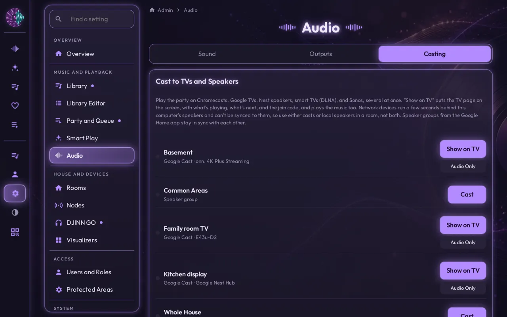

# Casting and Play here

Two ways to get the party onto speakers that aren't wired to the DJINN
computer: casting to network speakers and TVs, and **Tune In** on a phone or
laptop. For speakers in other rooms that should play in perfect step, use
[nodes](nodes.md) instead. The TV page and other screens are in
[Screens and visualizers](screens-and-visualizers.md).

## Cast to TVs and speakers

**Admin > Audio > Casting** plays the party on Chromecasts, Google TVs, Nest
speakers, smart TVs (DLNA) and Sonos, several at once.

1. Make sure the devices are switched on and on the same Wi-Fi as this
   computer.
2. Tap **Look for Devices**.
3. For each device, tap **Cast** (or **Audio Only**), or **Show on TV** for a
   screen.

**Show on TV** puts the TV page on the screen, with what's playing, what's
next and the join code, and plays the music too. Each cast shows its
**Volume** (on a TV, the volume is set on the TV). **Stop** ends one cast, and
**Stop All Casts** ends them all. Casts that were playing come back after
DJINN restarts, and a cast that drops is retried by itself.

Network devices run a few seconds behind this computer's speakers and can't be
synced to them. Use either casts or local speakers in a room, not both.
Speaker groups from the Google Home app stay in sync with each other.

**Casts and rooms:** a cast device belongs to Main unless you put it in
another room under [Rooms](rooms.md#casting-in-a-room); it then plays that
room's music.

**New Stream Address:** the casts play a live stream with a private address.
If you think someone has the address who shouldn't, this gives the stream a
new one. Anyone listening with the old one stops, and casts restart.

Players that can open a stream address (like VLC) show "Artist - Title" as
songs change.

## Play here

**Tune In** on the Playing tab plays the party on the phone, tablet or laptop
you're using: an extra speaker for another room, or the party on your
headphones. It's off until the host turns it on under **Admin > Party and
Queue > Play here**; then anyone at the party can use it, guests included.
Each person starts out not listening; **Tune In** lights up while it plays.

- Tap **Tune In** to start, and again to stop. It keeps playing while you
  browse, and the phone's lock screen shows the song and a pause button. If
  the connection drops, it reconnects by itself.
- Use the device's own volume; the Playing tab's volume is the main speakers'.
- Like casting, it runs a few seconds behind the speakers.
- Tune In plays the room you're in. Switching rooms while listening switches
  to that room's music.
