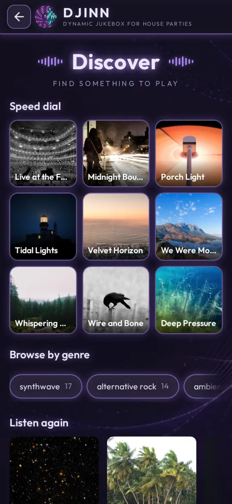
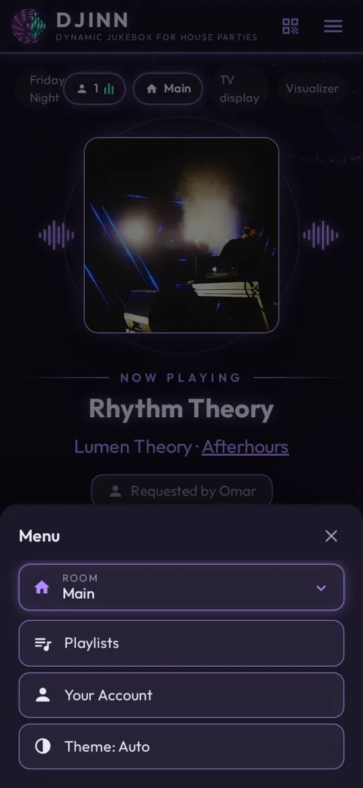
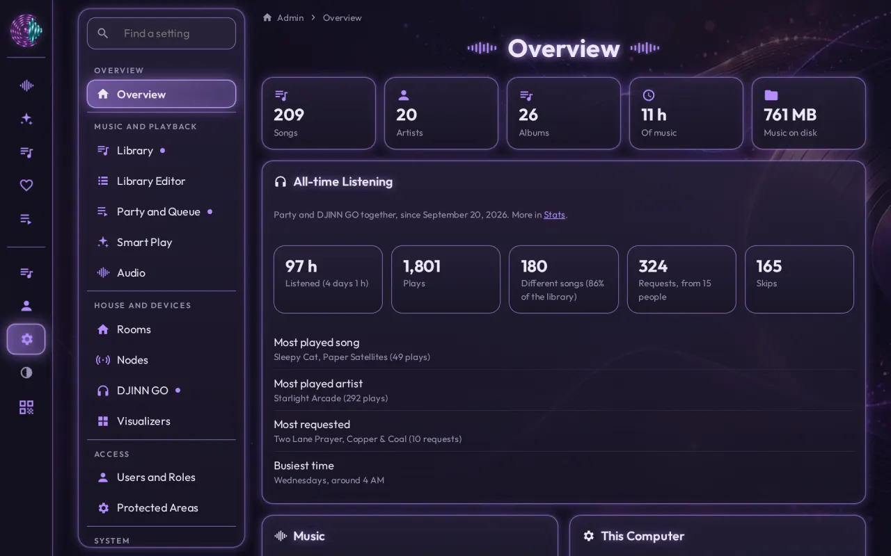

# Getting started

DJINN runs on one computer, the one connected to your speakers. That computer
is your **main DJINN**: it holds the music library and runs the party.
Everyone else uses their phone's browser, with no app to install. More
computers can join later as **nodes** that play other rooms (see
[Nodes](nodes.md)).

## Pick how to install

| You have | Use |
| --- | --- |
| A Windows 10 or 11 PC | The Windows installer |
| A Linux PC you already use | The Linux install command |
| A spare PC to give over to DJINN | The PC install disc (erases that PC) |
| A Raspberry Pi | The Raspberry Pi image |

Everything is on the
[Releases page](https://github.com/jmarasch/DJINN/releases/latest).

### Windows

Download and run `djinn-setup-windows-x86_64.exe`. It installs for your user
only and needs no admin rights. (The other `.exe`, `djinn-windows-x86_64.exe`,
is the program on its own, which DJINN downloads when it updates itself. You
don't need it.)

- The installer isn't code signed, so Windows may say "Windows protected your
  PC". Click **More info**, then **Run anyway**. If the installer does nothing
  at all, Smart App Control is blocking it; see
  [Troubleshooting](troubleshooting.md).
- On first start Windows asks whether DJINN may use the network. Allow
  **private networks**, or phones won't be able to reach it.
- The installer starts DJINN when you sign in to Windows, unless you untick
  that, and can add a desktop shortcut.

### Linux

For a 64-bit PC with Ubuntu 22.04 or newer, Debian 12 or newer, Fedora, Mint,
Arch or similar:

```sh
curl -fsSL https://github.com/jmarasch/DJINN/releases/latest/download/install.sh | sh
```

Add `-s -- --autostart` after `sh` to start DJINN when you log in. To look
before you run it, download `djinn-linux-x86_64.tar.gz`, unpack it, and run
`./djinn/install.sh`. It needs no root rights.

### PC install disc

`djinn-installer-pc-x86_64.iso` turns a spare PC into a DJINN box with nothing
else on it. Write it to a USB stick (with Rufus, balenaEtcher or Raspberry Pi
Imager) and start the PC from it. The PC needs internet during the install,
since Debian Linux is downloaded as it installs; a network cable is the
safest way.

The boot menu has two choices:

- **Install DJINN (headless; erases the disk you choose)** for a box with no
  screen.
- **Install DJINN with a screen (shows the TV page)** for a box with a TV or
  monitor attached. The screen shows the setup address until DJINN is set up,
  then the now-playing TV page.

The installer asks only for the time zone, the box's name (`djinn` is
suggested), a maintenance login (a username and password for repairs over the
network), and which disk to erase. Everything else is automatic. Security
updates for the system install themselves.

### Raspberry Pi image

`djinn-pi-arm64.img.xz` is for a Raspberry Pi 3, 4 or 5;
`djinn-pi-armhf.img.xz` works on every Pi, including older and Zero models.
Write it to a memory card with **Raspberry Pi Imager** (choose **Use custom**).
In Imager's settings you can give the Pi a name and an SSH login. A Pi makes a good node for another room, or a small main DJINN.

On a disc or Pi install, DJINN runs as a background service, your music goes
in `/srv/music`, and the box shows up on your network as
`http://djinn.local:8066` (or the name you chose).

## First start

1. **Open the setup page.** On Windows and Linux, DJINN opens your browser by
   itself. On a disc or Pi install, open `http://djinn.local:8066` on any phone
   or computer on the same network. If a screen is attached, it shows the
   address and a QR code to scan.
2. **Main DJINN or node?** If this is your first DJINN, choose **Main DJINN**.
   Choose **Node** only if you already have a main DJINN and want this computer
   to play another room. If DJINN hears a main DJINN on your network it asks
   **Is This Box a Node?** first.
3. **Create the admin account.** Pick a username and a password of at least 8
   characters. This is the host account. You can add more people later.
4. **Add your music.** Pick the folders where your music lives and DJINN
   starts reading them. You can add more later under **Admin > Library >
   Folders and Checks**, or choose **Skip for Now**.
5. **Let people in.** Show the join QR code with the **Join** button at the
   top of the app, or from the tray icon: **Show join QR code**. Guests scan
   it with their phone camera, type their name, and they're in. See
   [Guests and requests](guests-and-requests.md).

On a box with no keyboard you never need one: everything is set up from the
browser on another device.

### Getting music onto a disc or Pi box

Copy your music into `/srv/music` over the network with the maintenance login
(any SFTP program works, for example WinSCP on Windows or the file manager on
Linux and macOS: connect to `sftp://djinn.local`). Or keep your music on a
shared folder or drive and add that folder under **Admin > Library**. People
can also send songs through DJINN GO's **Submit music**, which you approve in
Admin (see [DJINN GO](djinn-go.md)).

## The tray icon

On Windows and Linux desktops DJINN lives in the system tray, by the clock.
Its menu has **Open DJINN**, **Show join QR code**, **Open TV page** and
**Shut down DJINN**. Clicking the icon opens DJINN. Without a desktop (a disc
or Pi install), there is no tray; DJINN runs in the background.

A node's tray menu is different; see [Nodes](nodes.md).

## Around the app

On a phone, the bar along the bottom has:

- **Playing:** what's on now and what's coming up, with lyrics, the
  visualizer, the mood dial and, for admins, play, pause, skip and volume.
- **Discover:** ideas for what to play: new albums, popular songs, mixes made
  from what you listen to, throwbacks and genres to browse.
- **Library:** search, and browse artists, albums, songs and genres.
- **Favorites:** the songs, albums and artists you've hearted (for accounts,
  not guests).
- **Queue:** the songs people have asked for.



Along the top are the DJINN logo, **Join** (the QR code icon) and the
**Menu**, which holds **Playlists**, **Your Account**, **Admin** (for admins)
and the theme (**Auto**, **Light** or **Dark**). The **room picker** shows on
the Playing and Queue tabs when your house has more than one room.



On a computer or tablet (900 pixels wide or more), the same tabs and menu
items form a menu down the left side.

### Admin

**Admin** has a menu down the left side, grouped into:

- **Overview:** the health dashboard: what's playing, library and background
  work, warnings, and all-time listening.
- **Music and Playback:** Library, Library Editor, Party and Queue, Smart Play,
  Audio.
- **House and Devices:** Rooms, Nodes, DJINN GO, Visualizers.
- **Access:** Users and Roles, Protected Areas.
- **System:** AI, System.
- **Activity and Logs:** Stats, Request Log, Server Log, Sign-In Log, Library
  Problems.



Some sections have tabs along the top (Library, Audio, Smart Play and AI).
**Find a setting** at the top of the menu searches every setting by its
wording and jumps to it. A dot next to a section means something there has
been changed from its default. On a phone, Admin starts with the list of
sections; tap one to open it.

## Where DJINN keeps its things

- **Windows:** the program and its settings, database, log, artwork and AI
  models are in `%LOCALAPPDATA%\Programs\DJINN`. Uninstall from Settings >
  Apps; Windows asks whether to remove your settings too.
- **Linux:** the program is in `~/.local/bin`, and settings and the database
  in `~/.config/djinn/`. Uninstall with `./djinn/install.sh --uninstall`.
- **Disc and Pi installs:** the program is in `/opt/djinn`, settings in
  `/etc/djinn/config.toml`, the database in `/var/lib/djinn`, and music in
  `/srv/music`.

DJINN only reads your music folders. The one exception is the Library Editor,
which can change tags and files, and only in folders you've allowed it to
(see [Library Editor](library-editor.md)).

## Ports

DJINN uses two network ports: **8066** for the party app, Admin, the TV page
and casting, and **8067** for DJINN GO, your personal listening and phone
apps. Both can be changed under **Admin > System**.
