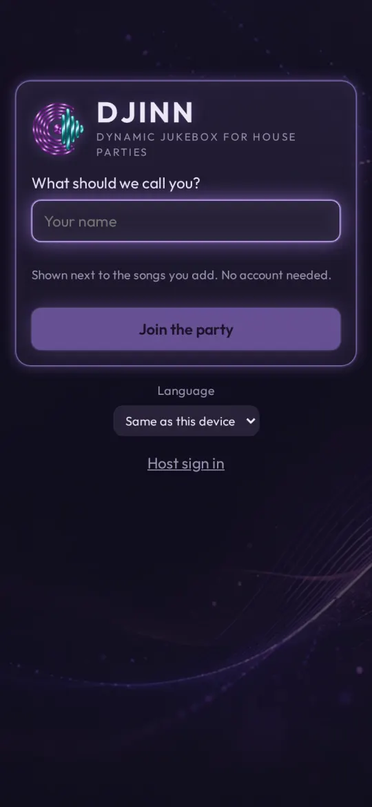
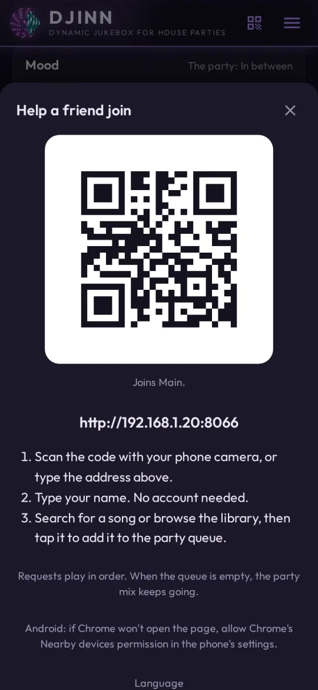
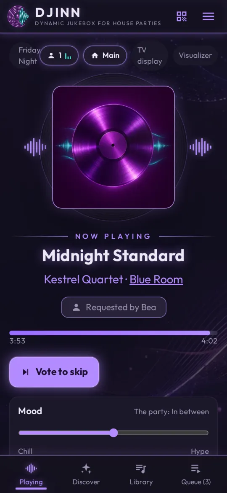
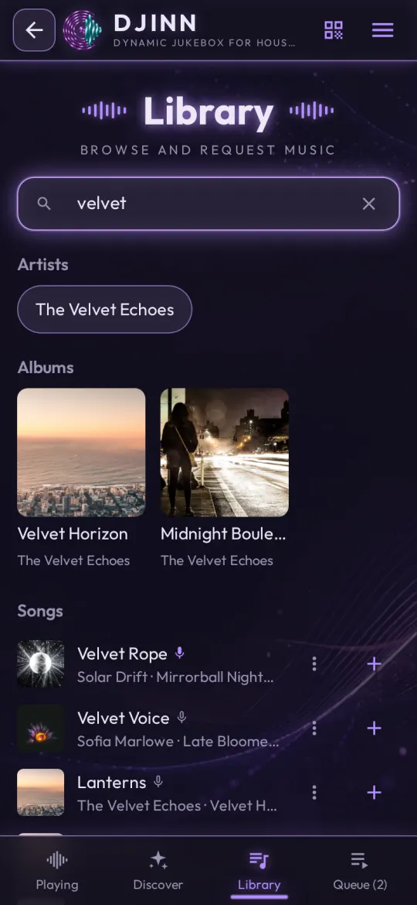
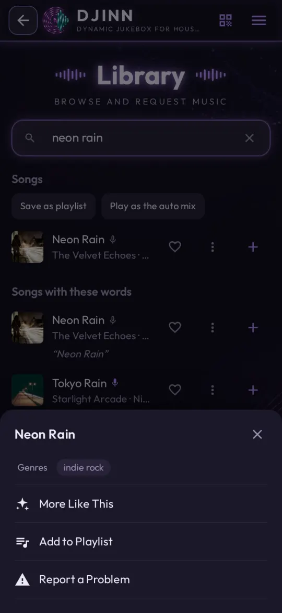
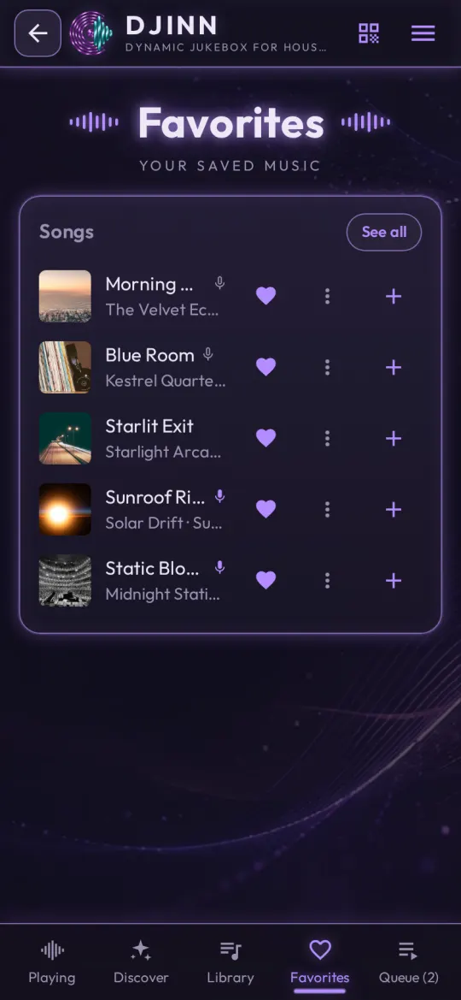
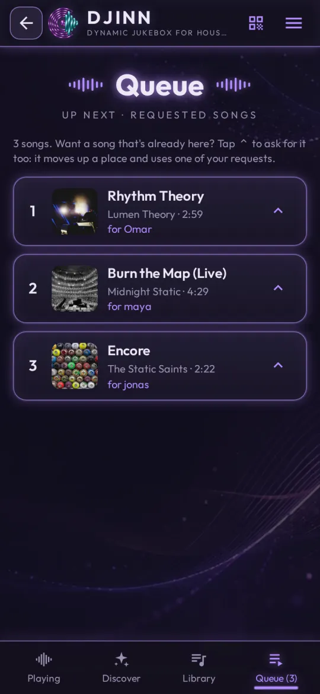
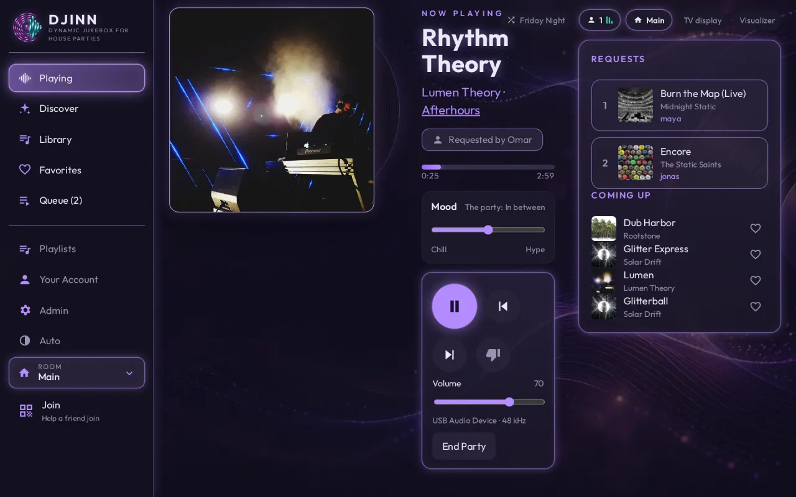

# Guests and requests

This page is about the party app: what people see on their phones, and how
asking for songs works.

## Joining

Guests scan the join QR code (or type the address under it) on the same
network as DJINN. The QR code is on the **Join** button, the TV page, and the
tray icon's **Show join QR code**. What happens next depends on
[guest mode](party-and-queue.md#guest-mode):

- **Guest mode on:** they type a name and tap **Join the party**. No account
  needed. The name shows next to the songs they add. Next time, the same
  phone is welcomed back by name.
- **Guest mode off:** they sign in with an account: one you made, one they
  made from an invite link, or one they signed up for, if you allow that. See
  [Accounts and roles](accounts-and-roles.md).

Hosts sign in with **Host sign in** at the bottom of the guest screen.

The **Join** screen also has **Help a friend join**: hand your phone to a
friend, or let them scan the code from your screen.

If your house has several rooms, each room has its own QR code, and scanning
it puts the phone in that room. See [Rooms](rooms.md).

## The Playing tab

The Playing tab shows the song that's on, its cover, who asked for it
("Requested by..."), and what's coming up. Under that:

- **Requests:** songs people asked for, in the order they'll play.
- **Coming up:** what the auto mix plans to play after the requests.
- **Lyrics:** when the song has lyrics, they show under the cover, and timed
  lyrics light up line by line as they're sung. On a phone, tap them to fill
  the screen.
- **Mood:** the mood dial, when the host has it on. Slide it from **Chill** to
  **Hype** to nudge what the auto mix picks next. Everyone's setting counts,
  and the dial shows what the party as a whole wants and how many people are
  nudging. See [Smart play](smart-play.md#the-mood-dial).
- **Tune In:** listen to the party on your own phone, for example in another
  room or with headphones. It runs a few seconds behind the speakers; use your
  phone's volume. Only shows when the host allows it (**Play here** under
  [Party and Queue](party-and-queue.md)).
- **TV display** and **Visualizer:** open the full-screen now-playing page or
  a visualizer in step with the room's speakers. See
  [Screens and visualizers](screens-and-visualizers.md).

Admins also get the controls: start over, play and pause, skip, **Skip and
play less like this**, volume, and **End Party**. See
[Running the party](#running-the-party-admins).

## Asking for a song

Search or browse the **Library**, or pick something from **Discover**, and
tap a song to add it to the queue. "Added to the queue" pops up, with
**Undo**. Requests play in order, before anything from the auto mix.

- **Taking one back:** on the Queue tab, tap × next to your own song. On the
  Playing tab, tap the check next to it.
- **Asking for it too:** if someone already queued the song you want, tap the
  up arrow next to it on the Queue tab. It uses one of your requests and
  moves the song up a place: songs more people want play first. If you change
  your mind, tap **Step back**. If the person who asked first takes theirs
  back, the request passes to the next person who asked for it.
- **Limits:** each person can have a few songs queued at once (3 by default)
  and the whole queue can be capped. See
  [Party and Queue](party-and-queue.md). Admins, people you mark **No limit**
  under **Admin > Users and Roles**, and roles with unlimited requests aren't
  limited.
- **Not in the library?** Under search results, **Ask for it** sends the
  host the artist and song you wanted. When that song later turns up in the
  library, the wish is granted. Only admins see this button unless the host
  lets everyone ask (see [Stats and history](stats-and-history.md#the-wishlist)).

In a house with rooms, you ask for songs in the room you're in. The room
picker on the Playing and Queue tabs switches rooms.

## A song's menu

The **...** button next to a song opens its menu:

- **Genres** and **Sounds like:** tap one to open that genre's page. "Sounds
  like" are styles DJINN's AI heard in the song, when AI listening is on.
- **More Like This:** songs that sound similar.
- **Add to Playlist** (accounts, not guests).
- **Report a Problem:** tell the host the title, artist or album is wrong, the
  cover is wrong, it sounds bad or cuts off, or it plays a different song.
  Reports land on the Library Editor's **Library Problems** tab.

Admins also get **Start Radio from This Song**, **Edit Tags** and, when the
song has lyrics, **Remove Lyrics**. Under lyrics there's also a **Report these
lyrics** link, for lyrics that belong to another song, are out of time, are
garbled, or have parts missing.

## Favorites

People with an account (not guests) can heart songs, albums and artists with
the heart button. The **Favorites** tab lists them. These are the same
favorites as in DJINN GO and the Android app.

## Skipping

- **Admins** skip right away with the skip button.
- **Whoever requested a song** can always skip it alone (**Skip my song**).
- **Everyone else** can vote, if [skip votes](party-and-queue.md#skip-votes)
  are on: the song is skipped once enough people tap **Vote to skip**. The
  button shows how many votes there are and how many are needed. After voting
  on one song, you sit out the vote on the next.

A plain skip doesn't count against a song, since it may only mean someone
wanted the next one sooner. **Skip and play less like this** (admins), and a
song sent away by the room's skip votes, do teach
[smart play](smart-play.md) to play it, and songs like it, less often.

## Running the party (admins)

On the Playing tab, admins have:

- **Start over:** play the song again from the beginning.
- **Play** and **Pause**, **Skip**, and **Skip and play less like this**.
- **Volume** for the room's speakers.
- **End Party:** stops the music in every room, empties every request queue,
  and switches the auto mix off. The house goes quiet, so heavy background
  work (like sound analysis) can run.

On the Queue tab admins can remove any request and move songs up or down.
Songs that the same number of people asked for can be reordered; a song more
people asked for stays ahead.

**Admin > Request Log** lists every request with who made it and from which
device. **Clear** empties the log; artist pages keep counting their top songs.

## Guests and accounts

Under **Admin > Users and Roles**:

- **Accounts, roles, invites and sign-ups:** see
  [Accounts and roles](accounts-and-roles.md).
- **Guests:** everyone who joined with just a name, by device (recognized by
  its network address), with how many songs they requested. Give a guest **No
  limit**, or remove them (their queued songs go too).

## Language

DJINN speaks English, Spanish and German. Under **Admin > System >
Language** the host picks the **Default language** for every screen, or
**Each device's own language** (the default) so every phone shows its own.
People with an account can choose their own under **Your Account >
Language**, which wins over the default on that device.
