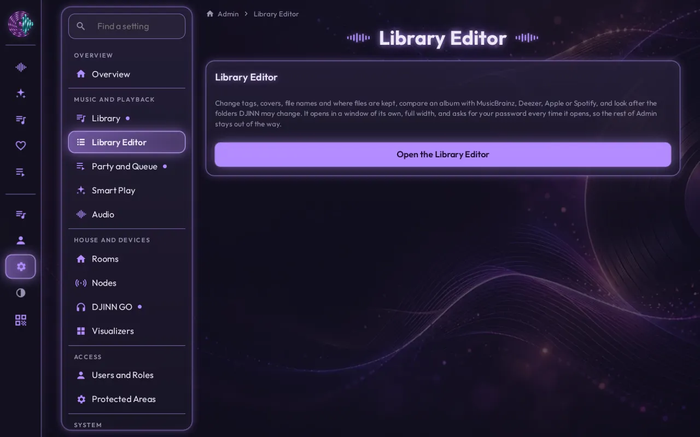
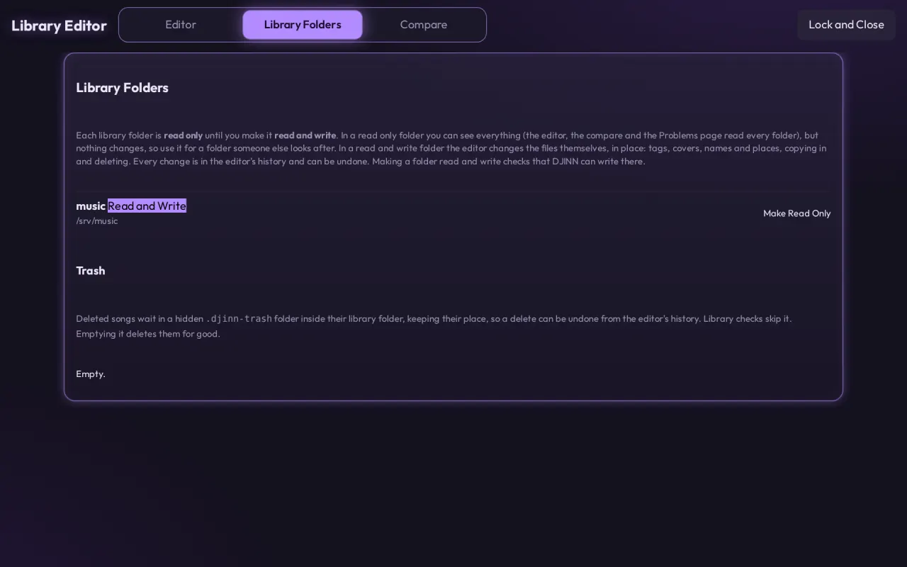
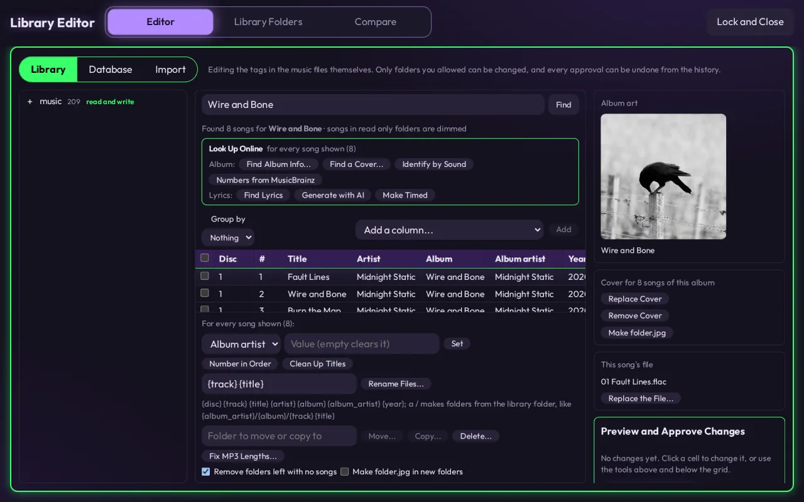
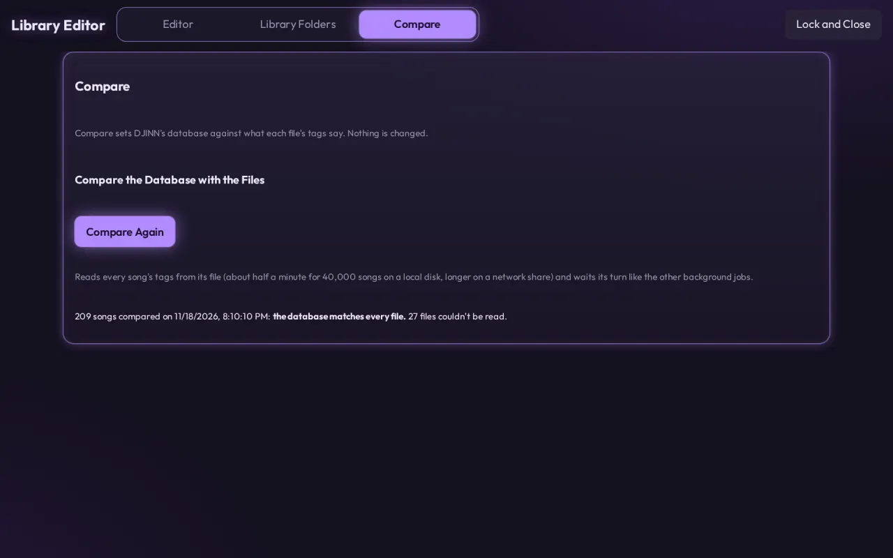

# Library Editor

The Library Editor is where you tidy your music: change tags, covers, file
names and where files are kept, compare an album with MusicBrainz, Deezer,
Apple or Spotify, bring in new albums, and find lyrics. It works like a
spreadsheet, and nothing is changed until you approve it. Every change to a
file can be undone.

## Opening it

**Admin > Library Editor > Open the Library Editor** opens it in a window of
its own, full width, so the rest of Admin stays out of the way. Because it can
change your music, it's a [protected area](accounts-and-roles.md#protected-areas):
it asks for your password (and, at the strictest level, a code from your
authenticator app) every time it opens. It locks again when you close the
window, press **Lock and Close**, or leave it ten minutes.

[Library problems](library-problems.md) open the editor straight on the songs
involved with **Fix in the Editor**.

The window has four tabs: **Editor**, **Library Folders**, **Compare** and
**[Library Problems](library-problems.md)**.

## Library folders: what may be changed

Every library folder is **Read Only** until you make it **Read and Write**,
on the **Library Folders** tab.

- In a read only folder you can see everything (the editor, the compare and
  the Problems page read every folder), but nothing changes. Use it for a
  folder someone else looks after.
- In a read and write folder the editor changes the files themselves, in
  place: tags, covers, names and places, copying in and deleting.

Making a folder read and write tests that DJINN can write there (it makes and
removes a tiny file), so a read-only drive or a share without rights is
reported straight away. The choice is recorded in the audit trail.

**Trash:** songs you delete wait in a hidden `.djinn-trash` folder inside
their library folder, keeping their place, so a delete can be undone from the
history. Library checks skip it. **Empty the Trash** deletes them for good.

## What you're editing

At the top, choose **What you are editing**:

- **Library** (outlined green): the tags in the music files themselves. Only
  read and write folders can be changed, and every approval can be undone
  from the history.
- **Database:** DJINN's own copy of the tags. The files are left alone (like
  **Edit Tags** in a song's menu). Clearing a cell goes back to the file's
  value.
- **Import** (outlined pink): new albums waiting to go into the library. See
  [Bringing in new albums](#bringing-in-new-albums).

## The editor

The editor has three parts:

- **Left:** your library folders as they are on disk. Open a folder to see
  the folders inside it; choose one to see its songs.
- **Middle:** the songs in a grid, one row per song.
- **Right:** the album's cover with its controls, and **Preview and Approve
  Changes**.

**Find songs** above the grid searches the whole library by artist, title or
album, across folders (`a | b` finds either). Useful for fixes that cross
folders, like an artist spelled two ways.

### The grid

- **Click a cell to change it.** Changed cells stay highlighted until you
  approve them, and show what they were.
- **Sort** by any column: click its header; again to reverse; a third time
  goes **Back to folder order** (folder, disc, track).
- **Group by** disc, album or folder. A group's tick box picks all its songs.
- **Pick songs** with the tick boxes. Tools below the grid work on the picked
  songs, or on every song shown when none are picked.
- **Columns:** take a column off with its ×, or **Add a column...** for other
  tags in the files (label, composer, ISRC, barcode and many more; Library
  side only). Your column choice is kept in this browser.
- Songs in read only folders are dimmed.
- The **Lyrics** column shows **Timed**, **Words** or **None**, and when the
  AI is working on a song.

### Tools

Above the grid:

- **Find Album Info...:** opens [Album layout](#album-layout).
- **Find a Cover...:** covers from MusicBrainz, Deezer, Apple Music and
  Spotify, side by side.
- **Identify by Sound:** each song's fingerprint goes to AcoustID, then
  MusicBrainz: title, artist, album, year and genre come in as changes to
  approve. Needs the AcoustID key and MusicBrainz contact (**Admin > Library >
  Online Info**).
- **Numbers from MusicBrainz:** track and disc numbers for the chosen song's
  album, from its track list on MusicBrainz, matched by title.

Below the grid, for the picked songs (or every song shown):

- **Set** a field to a value (empty clears it).
- **Number in Order:** track numbers 1, 2, 3... in the grid's order, for each
  album and disc.
- **Clean Up Titles:** takes off a leading track number and leftovers like
  "(Official Video)" or "[HD]".
- **Rename Files...** (Library only): new file names from a pattern, like
  `{track} {title}`. You can use `{disc}`, `{track}`, `{title}`, `{artist}`,
  `{album}`, `{album_artist}` and `{year}`; a `/` makes folders from the
  library folder, like `{album_artist}/{album}/{track} {title}`. A `.lrc`
  beside a song follows it.
- **Move...** or **Copy...** to another folder (a copy becomes a song of its
  own). **Remove folders left with no songs** and **Make folder.jpg in new
  folders** tidy up afterwards.
- **Delete...:** into the trash in their library folder.
- **Fix MP3 Lengths...:** see [MP3 length headers](#mp3-length-headers).

Rename, move, copy and delete show a preview of every file first ("New file
names", "New places") and ask before they go ahead. Names come from the tags
as DJINN shows them, with its corrections.

### Covers

The right side shows the album's cover. **Replace Cover** (from a file),
**Remove Cover**, **Use the Files' Cover** (undo a cover chosen in DJINN) and
**Make folder.jpg** (saves the cover as `folder.jpg` in the songs' folders).

Click the cover to open it bigger in the **Album Cover** window: **Replace
from a File...**, or **Search Online** for covers from MusicBrainz, Deezer,
Apple and Spotify at once, and **Use This Cover**. Covers are put on straight
away (and can be undone from the history).

### Preview and approve

Nothing is written until you approve. **Preview and Approve Changes** lists
every change, song by song, with what it was and what it becomes, and where it
goes: into the files, or into DJINN's database. **Leave this one** drops a
single change. **Approve Changes** writes them all; **Throw Them Away**
discards them.

### History and undo

**Changes made to files** lists every approval that changed files: tags,
covers, names and places, deleted files, copies, empty folders, `folder.jpg`,
MP3 lengths and replaced files. **Undo** puts a whole approval back: the
tags, the cover, the names, a deleted file (until the trash is emptied). An
undo shows in the history too.

A song DJINN only retagged keeps its sound analysis and everything else it
knew about it.

### Replacing a file

For a song that won't play, or a poor copy, **Replace the File...** puts a
better file in its place. It must play. The song keeps its place in playlists,
its plays and likes; the old file is kept so the replacement can be undone.
The new file is analyzed again.

## Album layout

**Find Album Info...** opens **Album Layout**, which works like MusicBrainz
Picard: it lays your songs on an album's real track list.

1. **Where to look:** MusicBrainz (it lists every release of the album, like
   the original, a deluxe edition or a reissue), Deezer, Apple Music, or
   Spotify (needs its account under **Admin > Library > Online Info**). Search
   by artist and album if what it found first is wrong.
2. **Pick a release** on the left. DJINN places each song on its track by
   title and length; songs it can't place go to **Unknown**. Each song shows
   its file name, length and folder.
3. **Drag a song onto its track** (or tap it, then tap the track). Dropping it
   on Unknown takes it off.
4. **Take from the Release:** choose which tags to take. Only what the release
   actually has is offered: titles, track and disc numbers, album, each song's
   artist, year, genre, cover, and on the Library side other tags like label,
   barcode and ISRC.
5. **Use This Layout.** The tags go to the grid as changes to approve. The
   cover is put on straight away (it can be undone).

YouTube Music has no way for other programs to search it, so it isn't one of
the sources.

**Setting up Spotify:** at
[developer.spotify.com/dashboard](https://developer.spotify.com/dashboard),
choose **Create app**: any name and description, a Redirect URI (Spotify asks
for one; DJINN doesn't use it), tick **Web API**, and save. Open the app's
**Settings**, copy the **Client ID**, choose **View client secret** and copy
that. Paste both under **Admin > Library > Online Info > Spotify Account for
Album Lookups**; saving checks them with Spotify. DJINN only contacts Spotify
when you search there.

## Bringing in new albums

The **Import** side is for new music: work on albums before they go into the
library. They wait in DJINN's own folder until you approve or throw them away.

1. **Bring In** **A Folder...** or **Song Files...** (song files you pick go in
   as one import).
2. For a folder, say how **The folder is laid out**, so DJINN splits it into
   one import per album:
   - **One album:** Album / songs (disc folders like CD1 are fine).
   - **One artist's albums:** Artist / Album / songs.
   - **Artist and album folders:** Music / Artist / Album / songs.
   - **A folder of albums:** Albums / Album / songs.
   - **Something else:** one import; folder names aren't used.

   **Fill missing album, artist, disc and year from folder names** fills tags
   the files lack from the folder names (a year in the folder name and CD1
   disc folders are read too), and track numbers from file names like
   `01 song.flac`.
3. Each file is checked to make sure it plays. The imports are listed on the
   left; choose one.
4. **Opening an import** looks it up on Deezer once. When Deezer knows the
   album exactly (same number of songs, every song on a track, album and
   artist names agreeing), its tags are filled in as highlighted changes, and
   its cover too when the files have none. Otherwise use **Find Album
   Info...** to pick the album yourself.
5. Fix anything else in the grid, as for any songs. Every tool works on the
   waiting files.
6. Check **Where each song goes**: a live preview of each song's new place
   in the library folder you chose under **Into**, named from its tags (the
   **Placed as** pattern, where a `/` makes folders).
7. **Approve Import** writes the changes and moves the songs into the
   library. The editor stays on Import with the next album. When every import
   is in, it says "Every import is in the library."

**Take Picked Out** removes songs from an import (their files are deleted),
and **Throw This Import Away** discards a whole import. Undoing an approved
import from the history takes its songs out of the library again.

Imported lyrics (a `.lrc` beside a file) go into the library with the song.

## Lyrics and sound tools

Under **Lyrics:**, for the picked songs, in the library or in an import:

- **Find Lyrics:** the song's own lyrics (a `.lrc` beside it or its tags),
  then LRCLIB. For songs with none anywhere, it offers **Generate Them with
  AI**.
- **Generate with AI:** the [AI listener](lyrics.md#ai-lyrics) listens to the
  songs and writes their lyrics; it may get words wrong. This works even for
  genres left out of AI lyrics, and even when background work is held.
- **Make Timed:** for songs with words but no timing: LRCLIB's timed lyrics
  when it has them, otherwise the AI listener times the words.

The AI listener has to be installed first (**Admin > AI > Lyrics**).

## MP3 length headers

Variable bit rate MP3s with no length header look several times too long in
other players and phones (DJINN works out their real length already).
**Fix MP3 Lengths...** writes the header, as the LAME encoder does; the sound
isn't touched, and it can be undone from the history. If every MP3 shown
already has one, it says so.

To fix them:

1. On the **Library Problems** tab, open **MP3s with no length header** and
   select **Fix in the Editor** beside a song. The Editor tab opens on its
   folder.
2. The first time, go to the **Library Folders** tab and make the folder that
   holds the songs **Read and Write**. Every folder is read only until you do.
3. Back on the **Editor** tab, choose **Library** at the top (the files, not
   only DJINN's database).
4. Pick the MP3s in the grid, or pick none to fix every song shown.
5. Select **Fix MP3 Lengths...** under the grid. It lists the files that need
   a header; select **Fix**, then **OK**.

To fix a whole artist at once, open a folder higher up in the tree on the
left: the grid shows every song under it, 200 at a time (**Show more** loads
the next 200, and only songs loaded in the grid are fixed).

## Compare

The **Compare** tab sets DJINN's database against what each file's tags say,
for title, artist, album, album artist, track and disc number, year and
genre. **Compare Now** reads every song's tags from its file (about half a
minute for 40,000 songs on a local disk, longer on a network share). Nothing
is changed.

Each difference says why:

- **Corrected in DJINN:** you changed it with Edit Tags or Edit Album, or in
  the editor's Database side; the file still says the old value.
- **Filled in by identification:** the file has nothing there and an applied
  identification filled it in.
- **Other:** the file changed since DJINN read it, or the two readings differ.
  A library check re-reads changed files.

Filter by **Field** and **Folder**, or **Show All Differences**.
