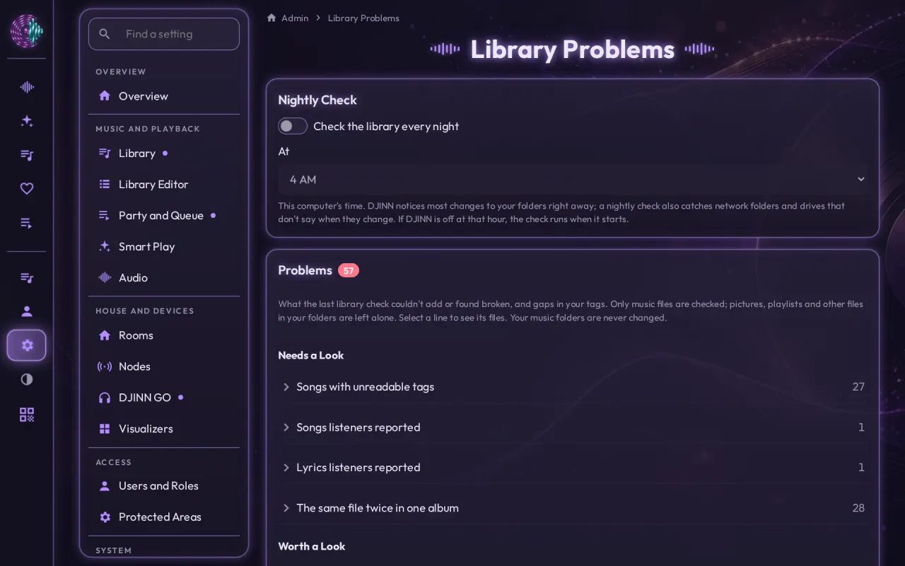

# Library problems

**Admin > Library Problems** shows what the last library check couldn't add or
found broken, and gaps in your tags, so you can tidy your library. Only music
files are checked; pictures, playlists and other files in your folders are
left alone. The menu shows a count when something needs a look.

DJINN never deletes or changes anything from here by itself. Each kind of
problem has a way to fix it: a button that opens the
[Library Editor](library-editor.md) on the right songs, or a plain hint.

## How the page works

Problems come in two groups:

- **Needs a Look:** things that are broken: music folders not found, folders
  and files DJINN can't open, names it can't read, formats it doesn't play,
  songs with unreadable tags, songs that won't play, what listeners
  reported, and copies (albums filed twice, the same file twice in one
  album).
- **Worth a Look:** things that work but could be better, like gaps in tags,
  messy titles or missing lyrics.

Open a kind to see its songs. **Hide This Kind** tucks away a kind you know
about and don't care to fix; hidden kinds are listed at the bottom, and
selecting one shows it again. **Download as a Spreadsheet** saves the list.
**Check Again** runs a library check.

If everything's fine, the page says "Every file in your music folders made it
in and plays."

## What's checked

**Broken:**

- **Music folders not found:** a folder that's unplugged, renamed or offline.
- **Folders and files DJINN can't open:** usually a permissions problem.
- **Names DJINN can't read:** file or folder names in an odd character set.
- **Formats DJINN doesn't play:** Opus, WMA, AIFF, APE and others.
- **Songs with unreadable tags:** the file plays, but its tags are damaged.
- **Songs that won't play:** found when a song fails while playing, or by a
  playlist's **Check files**. DJINN tries them again after each library
  check, and replacing the file clears them.
- **Songs listeners reported** and **Lyrics listeners reported:** from
  **Report a Problem** and **Report these lyrics**. **Done** clears a report.
  For lyrics, **Show Lyrics** and **Remove and Block** (see
  [Lyrics](lyrics.md#bad-lyrics)).

**Copies:**

- **Albums filed twice:** albums by one artist that hold almost the same
  songs (at least 85% of the larger one's song titles, nearly the same number
  of songs, and nearly the same total length): a copy in another folder, or
  the same album under a slightly different name such as "(Remastered)". A
  deluxe edition with extra songs, or a live album with the studio track
  list, isn't listed. **Compare in the Editor** shows both albums' songs
  together, so you can set aside the copy you don't keep.
- **The same file twice in one album:** same size, length and title.

**Tags:**

- **Songs with no artist**, **Songs with no album**, **Albums with no cover**,
  **Albums with no year**, **Albums with no genre**.
- **Songs with impossible numbers:** a track or disc number of 0 or less, a
  length of 0, a year like 9999.
- **Titles with leftovers:** a track number and separator in front ("01 - "),
  "(Official Video)", a web address, spaces around, all capitals.
- **File names that don't match the title:** the file's name and folders
  don't contain the title, ignoring spaces, dashes, colons, quotes and other
  punctuation.
- **Artists spelled two ways:** "The Beatles" and "Beatles", "AC/DC" and
  "ACDC".
- **Albums split across artist names:** an album's folder filed under two
  artists.
- **Albums with different covers inside.**
- **Albums with missing or repeated track numbers.**
- **Messy genre tags:** several genres run together with `;`, `|` or a
  backslash, ID3 genre numbers like "(17)", placeholders like "Unknown" or
  "Other", or very long genre text.

**Sound and files:**

- **Very short or very long songs:** under 10 seconds or over 3 hours.
- **Low-quality songs:** under 96 kbps. **Look for a Better Copy** finds
  songs with the same title in the editor.
- **MP3s with no length header** (see [MP3 lengths](#mp3-lengths)).
- **Songs with no loudness data** (only once other songs have it):
  **Measure Now** measures them.
- **No lyrics**, and **Lyrics an AI made** (with the model, how well it
  matched, and the zip it came from).
- **Songs that went missing lately:** gone from the library in the last 30
  days and not back under another path (a song you moved isn't listed).
  **Look for It** searches the editor in case it came back retagged.

Not checked yet: covers that are tiny, huge or not square, and silent or very
quiet files.

## Fixing problems

**Fix in the Editor** opens the [Library Editor](library-editor.md) on the
song's folder, or on a search for the songs involved (for artists spelled two
ways or albums split across artists, it finds every song involved, across
folders). The editor can only change files in folders you've allowed it to.

To fix by hand instead, change the files with your usual tagger or file
manager, then **Check Again**.

## Possible duplicates

The **Possible Duplicates** card finds songs that are in your library more
than once, by:

- **same title and artist**,
- **identified as the same recording** (from Identify songs), or
- **sound the same** (from [sound analysis](your-library.md#sound-analysis),
  which also finds copies that are named differently).

Each group lists the copy DJINN would keep first. **Not Duplicates** tells
DJINN two songs aren't copies, so it stops listing them. A song on both its
album and a greatest hits is fine, so by default only copies in the same
album (or with no album) are listed; **Also list copies in different albums**
shows the rest.

The auto mix treats every copy of a song as played when one plays (see
[Party and Queue](party-and-queue.md#repeats)).

DJINN never deletes files: remove or set aside the copies you don't want in
the editor, or in your music folders, then check for changes.

## The nightly check

DJINN notices most changes to your folders right away. **Check the library
every night** (off by default) also catches network folders and drives that
don't say when they change. Choose the hour **At** (04:00 by default, this
computer's time). If DJINN is off at that hour, it checks the next time it
runs.

After each nightly check, the card compares with the one before: songs
added and gone, problems needing a look, songs with copies, and songs
listeners reported, each with how it changed.

## MP3 lengths

Many MP3s have no length header, so a tag reader can only guess their length, and it guesses wrong (often several times too long) for variable bit rate files that open with a quiet stretch. DJINN looks at such files: if the bit rate is the same wherever it samples, the guess stands, otherwise it counts every frame, which is exact. The figure is kept in DJINN's database; your files are never changed. The first library check after an update re-reads every file once to correct existing songs.

A thorough check reads a few frames of every MP3 after startup and after
each library check, and lists those with no length header, whose lengths
players and phones may get wrong. **Read Every MP3 Again** starts it over. The
editor can add a length header to them (see
[Library Editor](library-editor.md#mp3-length-headers)).
