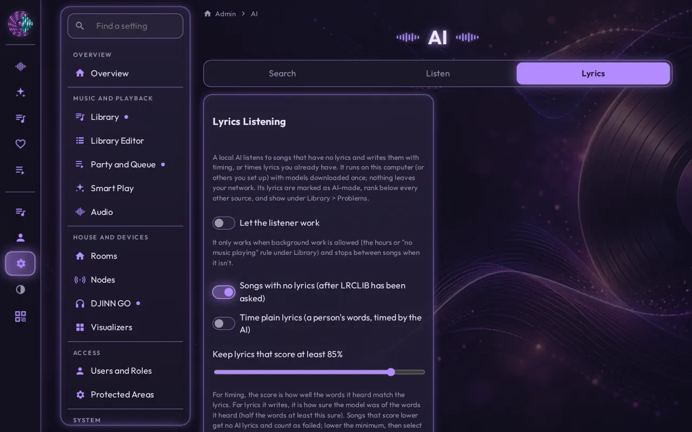

# Lyrics

DJINN shows lyrics on the Playing tab, in DJINN GO, in the Android app and on
the full-screen lyrics page. Timed lyrics light up line by line as they're
sung; plain lyrics show as text. Any lyrics can be searched by typing a line
of them.

Songs with lyrics have a small microphone next to them in lists: hollow for
plain lyrics, filled for timed lyrics, and red when lyrics an AI made were
removed as wrong. The Songs list can show only songs with lyrics, or only
timed ones.

## Where lyrics come from

1. **A `.lrc` file beside the song**, with the same name
   (`01 Song.flac` and `01 Song.lrc`). This always wins.
2. **The song's own tags** (the lyrics field most taggers have).
3. **LRCLIB**, a free, open lyrics site (lrclib.net), for songs with none of
   the above. On by default. Each song's artist, title, album and length are
   sent, one song at a time.
4. **Lyrics you import** from a zip (below).
5. **Lyrics an AI made** by listening (below). These rank last.

DJINN keeps lyrics in its own database and never writes them into your music
files. Lyrics are read after DJINN starts and after each library check, in
the background; the Library tab's progress shows it.

## The Lyrics card

**Admin > Library > Online Info > Lyrics** shows how many songs have lyrics
(and how many are timed, imported or made by an AI), and has:

- **Look up missing lyrics on LRCLIB:** on by default.
- **Show a note on lyrics an AI worked on:** a line under the lyrics saying
  an AI made the words, or timed them. On by default.
- **Lyrics page:** full-screen lyrics for a TV or spare screen, without
  signing in, at `/lyrics`. On by default. See
  [Screens and visualizers](screens-and-visualizers.md#the-lyrics-page).
- **Recheck Lyrics:** reads every song again (for `.lrc` files added since)
  and asks LRCLIB again.
- **Export .lrc Files:** downloads a zip of `.lrc` files laid out like your
  music folders and named like the songs, so unzipping it over a music folder
  puts each one beside its song.
- **Allow them again:** lets every removed or blocked lyric come back.
- **Import Lyrics from a Zip:** below.

## Importing lyrics from a zip

**Import Lyrics from a Zip** on the Lyrics card can load lyrics from a zip of
files. DJINN keeps them in its database and never writes to your music folders.

**The zip.** Lay the files out like your music folders, the same way **Export .lrc Files** does: under the name of the library folder, at the song's place, named like the song. For example, `Music/Artist/Album/01 Song.lrc` for `/srv/music/Artist/Album/01 Song.flac`. Use `.lrc` or `.txt`, as UTF-8 text.

- A `.lrc` file may start with the header lines `[ar:Artist]`, `[ti:Title]`, `[al:Album]` and `[length:mm:ss]`. DJINN matches the song by artist and title first, using album and length when several songs fit. When those lines are missing, and for every `.txt`, it matches by the path.
- Timed lines (`[mm:ss.xx]words`) make timed lyrics; anything else is plain lyrics. A file holding only `[Instrumental]` is ignored.
- A zip may hold up to 250 MB and 150,000 files, and each file up to 200 KB. For a bigger library, send several zips: the import is safe to repeat and any order works.

**What it does.** It only fills songs that have no lyrics. Lyrics from a `.lrc` beside the song, from the song's tags or from LRCLIB always win. By default it skips songs LRCLIB hasn't been asked about yet (while the LRCLIB lookup is on), so LRCLIB gets the first go; a tick box imports them anyway. Songs that already hold lyrics from an earlier import keep them unless you tick "Replace lyrics from an earlier import".

**Replacing other lyrics.** Normally an import only fills songs that have none. Tick "Let better imported lyrics replace lyrics from files, tags and LRCLIB" and an import also replaces those when it ranks better: timed over plain, or a person's words timed by an AI over plain words. Nothing replaces a person's timed lyrics with equal or worse ones, and lyrics an AI made by listening never replace anyone's. The song's file isn't read over the replacement until a recheck. The note under lyrics that an AI worked on can be turned off in the same panel.

**Safety.** Files are read only as text. A file that looks like code or markup (SQL, script or HTML tags, shell commands, binary data) is thrown out and listed as a warning, and program or data files in the zip (`.exe`, `.sql`, `.zip` and so on) are never read. Admin Home reminds you until you clear the report. The rest of the zip still imports.

**Lyrics an AI worked on.** A file whose header says so is stored as such, with the model, the zip it came from and when. Two kinds, both listed under Problems as **Lyrics an AI made** (with how well the timing matched, for the second):

- `[by:... (AI-generated; model=...)]`: an AI wrote the words by listening, so they are guesses. They show with a note, any other source replaces them, LRCLIB is still asked about those songs, and an import of ordinary lyrics replaces them without asking, even when the AI's are timed.
- `[by:... (AI-synced; model=...; match=84%)]`: a person's words that an AI timed. Timing beats plain words, so these replace plain imported lyrics; a person's own timed lyrics beat them, and so does anything beside the song. The notice line "(AI-generated lyrics)" at the top of such a file is not shown as a lyric. A title and credits line that lyrics websites put first (for example "Song (Guest) - Artist") is dropped when it names the artist and has a dash.

Timed lyrics are always preferred: if a song has both timed and plain imported lyrics, the timed ones are kept, and a later zip with timed lyrics takes the place of plain ones without asking.

When it finishes, the panel shows what was saved and skipped, and the full report can be downloaded. **Remove All Imported Lyrics** in **Admin > System > Clear and Reset** takes back everything that came from zips and leaves other lyrics alone.

## Bad lyrics

**Reporting:** under a song's lyrics, **Report these lyrics** (on the Playing
tab, in DJINN GO and in the Android app) lets anyone say they're another
song's lyrics, out of time with the music, garbled or in the wrong language,
or have parts missing. Reports show under
[Library problems](library-problems.md) as **Lyrics listeners reported**.

**Removing:** in a song's menu, admins can choose **Remove Lyrics**. From a
report, **Remove and block** takes the lyrics away and remembers which source
they came from (a `.lrc` file, the song's tags, LRCLIB or an import): that
source's same text isn't used for the song again. If the source gives
different text later, it is used. **Done** clears the reports and keeps the
lyrics. **Allow them again** on the Lyrics card lifts every block.

Removing lyrics an AI made marks the song with a red microphone, and the AI
doesn't try it again until you allow it.

## AI lyrics

**Admin > AI > Lyrics** lets a local AI make lyrics for songs that have none,
and time lyrics that are plain. It runs on your own computer (or others you
set up), with models downloaded once; nothing leaves your network. Its lyrics
are marked as AI-made and rank below every other source.



1. **Check This Computer.** The card shows whether Python, ffmpeg and an
   NVIDIA graphics card were found. The PC install disc already has Python and
   ffmpeg; on another system, install `python3`, `python3-venv` and `ffmpeg`
   first.
2. **Choose the Model.** Bigger is more accurate and slower: tiny and base
   suit a small processor, small a decent one, medium or large-v3-turbo a
   graphics card. **Isolate the vocals first** makes a much bigger download
   and is slower, but helps on loud mixes.
3. **Install the Listener.** DJINN sets up a private Python environment for
   it and downloads the model. This needs the internet once, unless the
   computer has an offline copy (see [below](#installing-without-internet)).
   After changing the model, use **Install Again**.
4. **Let the listener work**, and choose what it does:
   - **Songs with no lyrics** (after LRCLIB has been asked).
   - **Time plain lyrics** (a person's words, timed by the AI).
5. **Start it with DJINN** keeps it running after a restart.

It takes one song at a time, and only while
[heavy work](your-library.md#when-heavy-work-runs) is allowed; the card says
why it's paused when it is. It shows what's waiting, working, done and
failed.

**Keep lyrics that score at least:** 85% by default. For timing, the score is
how well the words it heard match the lyrics. For lyrics it writes, it's how
sure the model was of the words it heard. Songs that score lower get no AI
lyrics and count as failed, until you try them again.

**Genres to Leave Out:** songs in these genres get no AI lyrics (a genre
takes in its narrower ones, so "metal" covers "black metal"), unless you ask
for a song in the [Library Editor](library-editor.md#lyrics-and-sound-tools).
Handy for instrumental or classical music, or vocals the AI can't follow.

How AI lyrics show: a note under them says "Made by an AI listening to the
song, so it may have mistakes" or "Timing made by an AI listening to the
song", with how well it matched. They're listed under Library problems as
**Lyrics an AI made**.

### Other computers

A computer with a decent processor or graphics card can listen too. Under
**Other Computers**, type its name and **Make a Key** (shown once). Copy the
`ai-listener` folder from DJINN's data folder to that computer, and in it run:

```sh
python worker.py --server http://djinn.local:8066 --key KEY
```

Keys only work from your home network.

### Nodes help

[Nodes](nodes.md) can help too. In **Admin > Nodes**, open a node's **AI
Lyrics** and tick **Help with AI Lyrics**. The node gets everything it needs
from this server, never the internet: this server fetches the packages for
the node's Python once and hands over its own copy of the model. So install
the listener here first.

The model is suggested from the node's memory and processor (and one size
smaller if its speed test or its real songs show it's slow); you can pick
another. A node only works while it plays nothing and its screen shows no
visuals. It pauses the moment music or visuals start, so playback is never
affected, and carries on when they stop.

**Isolate the vocals here for nodes that help** (on by default): when this
computer has vocal isolation installed, it does the heavy part, separating
the voice from the music, and sends the node only the voice (a few
megabytes), which the node deletes when done. Without it, nodes listen to
whole songs.

With **Isolate the vocals first** on, this computer runs two jobs at once:
one separates the vocals of the next songs, the other listens to songs whose
vocals are ready. It keeps one song ready for each listener that's free (each
node free to help, and its own) and one spare, and every listener takes from
those, so every song gets the cleaner listen. **Listen on** chooses where its
own listening runs: the graphics card beside the vocal separation (faster),
or the processor, leaving the card to the separation.

**Give songs a node wasn't sure of to this computer's model** (on by
default): nodes run smaller models, which are less sure of what they hear.
When a node's lyrics score under the minimum, this computer's listener tries
the song with its bigger model before giving up, using the vocals already
separated. Songs a listener hears no singing in are marked as instrumentals,
so they no longer count as missing lyrics.

**Nodes Helping** lists every node switched on to help, with a light:

- **Green:** working, and the song it's on.
- **Yellow:** waiting for a song (none ready yet, or none need lyrics).
- **Red:** not available now: playing music, its song paused on this
  computer, playing its own songs while this computer is away, its screen
  showing the visualizer, or stopped by a problem.
- **Grey:** not able to help: not connected, not started yet, still
  installing, or AI lyrics work switched off here.

### Installing without internet

The listener's packages and models can come from an offline copy (the
"keepsake") instead of the internet. DJINN looks for one in its data folder
(`ai-listener/keep`) and in `/opt/djinn/keep`, so an install disc can carry
one. The keepsake is published as the `ai-keepsake` download on GitHub, in
parts; `install-keepsake.sh` from DJINN's source joins and unpacks them into
`/opt/djinn/keep`.
