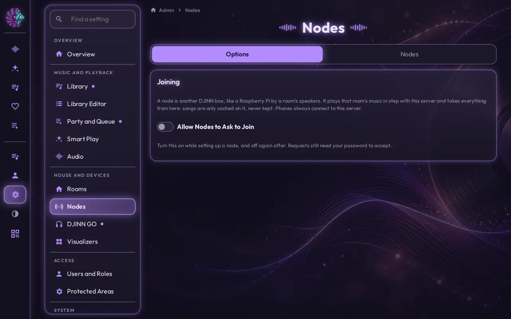

# Nodes

A **node** is another DJINN box, like a Raspberry Pi or an old PC by a room's
speakers. It plays one room's music in step with your main DJINN and takes
everything from it: songs, settings and updates. It has no library of its own,
and phones keep using the main DJINN.

Use a node to put music in a room that the main DJINN's own speakers can't
reach, or to put a screen (a TV with lyrics and visualizers) in a room.

## Setting one up

1. **Install DJINN on the box.** The easiest way is a
   [Raspberry Pi image or the PC install disc](getting-started.md#pick-how-to-install).
   The Windows and Linux installs work too.
2. **On the main DJINN**, open **Admin > Nodes** and turn on **Allow Nodes to
   Ask to Join**. Turn it off again once your nodes are in.
3. **On the new box**, open its page: `http://<its name>.local:8066` from a
   phone or computer, or the screen plugged into it. On the first-start page
   choose **Node** (if it hears your main DJINN it asks **Is This Box a
   Node?**; choose **Yes, Set This Up as a Node**). DJINN restarts as a node.
4. **Pick your main DJINN** from the list the node finds on your network, or
   type its address. Give the node a name ("Kitchen") and tap **Ask to Join**.
5. **Compare the codes.** The node shows **Main's security code** and **This
   request's code**. On the main DJINN, **Admin > Nodes** shows the node under
   **Asking to Join** with its code. If both codes match, enter your password
   and tap **Accept**. If they don't match, the node reached something else:
   **Decline** it and check the address.

Once accepted, the node gets a room of its own, which plays along with Main
until you change it under [Rooms](rooms.md). All communication between a node
and Main is encrypted, and the node remembers Main's certificate, so nothing
else can pretend to be Main later.

## Settings

**Admin > Nodes** lists every node with its room, whether it's **Connected**
(or when it was **Last seen**), and whether it runs the same build as Main.
**Admin > Rooms** shows nodes as endpoints too; drag one to another room.
Click a node (in either place) for its settings window:

### Speaker and Screen

- **Speaker:** which of the box's sound devices plays, its **Delay** and its
  **Volume trim** (on top of its room's volume; the node's own equalizer
  shapes its sound, not the main DJINN's). **Add Another Speaker** plays through more than one device
  on the node, each in step. A speaker that isn't connected is skipped.
- **Keep in step with the main DJINN:** on by default. The node eases its
  speed very slightly to stay with the main speakers, and only jumps if it
  gets more than a tenth of a second out. Off, it lines up when music starts,
  then plays straight through.
- **Songs to keep ready:** how many songs (from 1 to 50, 12 by default) the
  node keeps copies of: what's playing and coming up. A song is then ready
  before it starts, and the node can carry on if the main DJINN goes away.
- **If the main DJINN can't be reached:** **Play what's loaded, then stop**,
  or **Play what's loaded, then keep playing cached songs**. When Main is back,
  the node goes back to Main's music.
- **Equalizer for This Node:** shapes only this node's speakers, on top of the
  party mix.
- **On a screen plugged into this box:** what its screen shows; see
  [Screens and visualizers](screens-and-visualizers.md). **What the room
  says** follows the room's display settings.

To line a node's speaker up with the others in its room, use **Timing** on the
room (see [Rooms](rooms.md#timing)).

### AI Lyrics

A node can help make lyrics with AI while it's idle. See
[Lyrics](lyrics.md#nodes-help).

### This Node

- **Open the Node's Own Page:** see [Managing a node](#managing-a-node).
- **Kick and Wipe:** shuts the node out at once. It wipes every cached song,
  now if it's connected or when it next starts. To use it again, it has to ask
  to join again.

## Managing a node

**Manage** (in Admin > Nodes) opens the node's own page in the same window,
signed in for 12 hours, with a link back. Settings changes on the node's page
need this; nobody else on your network can change them. **Exit Node
Management** goes back to Main.

The node's page shows:

- **Status:** its room, Main's address and security code, the version, cached
  songs, how closely its clock is matched to Main's, and its speaker timing
  ("on time", or how far behind or ahead of Main).
- **Speaker Settings:** the same settings as above.
- **Diagnostics:** version and build, the system, how long it's been running,
  its network addresses and song cache, with **Restart Node** and, on boxes
  installed from a DJINN disc or Pi image, **Restart Computer** (for when the
  sound card is stuck and restarting the node didn't help).
- **Log:** what the node has recorded, with a level filter, search, **Keep
  updating** and **Download Log**.

The node's page is also at its own address, port 8066, any time
(`http://kitchen.local:8066`), showing its status.

## The node's tray icon

On a Windows or Linux desktop, a node's tray menu has **Show display**, **Node
status**, **Open main DJINN**, **Stop** (a tick box that stops this node's
music until you untick it), **Room** (move it to another room), **Screen
shows** (its own screen choice), **Show code** (the room's join QR code) and
**Shut down**.

## Updates

Nodes never update from the internet. Each time it checks in, a node tells
Main its version; when Main runs a newer one, Main fetches the matching file
for the node (checked against DJINN's signature) and hands it over. The node
checks it, replaces itself and restarts. Nodes are never moved to an older
version.

## If Main moves

If Main gets a new address (for example after a router change),
nodes look for it by its announcement on the network, its old addresses and
its name, and accept only Main's own certificate. They reconnect by
themselves.
