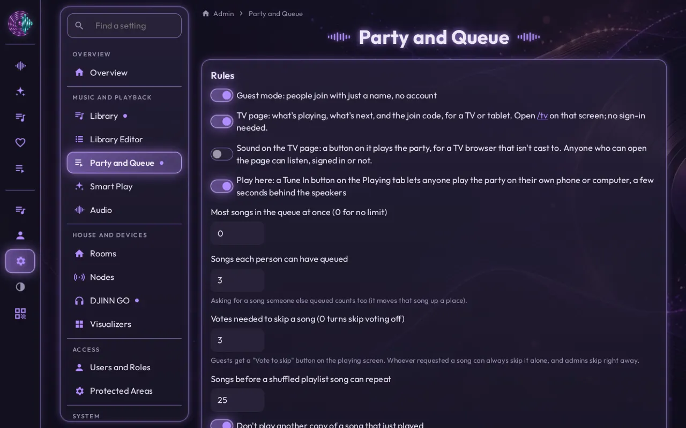

# Party and Queue

**Admin > Party and Queue** holds the settings for guests and the request
queue. Change what you need, then tap **Save**.

In a house with several rooms, these are Main's settings. Each room can have
its own queue limits and skip votes under **Admin > Rooms**; until you set
them, a room uses Main's. See [Rooms](rooms.md).

## Guest mode

**Guest mode: people join with just a name, no account.** Off by default:
everyone needs an account (see [Accounts and roles](accounts-and-roles.md)).
Turn it on for a party where friends of friends should be able to ask for
songs without signing up. See [Guests and requests](guests-and-requests.md).

## TV page

**TV page:** a screen showing what's playing, what's next and the join code,
for a TV or tablet. On by default. Open `/tv` on that screen (for example
`http://djinn.local:8066/tv`); no sign-in needed. See
[Screens and visualizers](screens-and-visualizers.md).

**Sound on the TV page:** a button on the TV page plays the party through the
TV's own browser, for a TV you can't cast to. Anyone who can open the page can
listen, signed in or not. Off by default.

## Play here

**Play here:** a **Tune In** button on the Playing tab lets anyone at the
party play it on their own phone or computer, a few seconds behind the
speakers. Off by default. See [Casting and Play here](casting-and-tv.md).

## The queue

- **Most songs in the queue at once:** 0 (the default) for no limit.
- **Songs each person can have queued:** 3 by default, from 1 to 50. Asking
  for a song someone else queued counts too (it moves that song up a place).

Admins, anyone marked **No limit** under **Admin > Users and Roles**, and
roles with unlimited requests skip both limits.

## Skip votes

**Votes needed to skip a song:** 0 (the default) turns skip voting off. With
it on, guests get a **Vote to skip** button on the Playing tab. Whoever
requested a song can always skip it alone, and admins skip right away. A song
sent away by votes counts double against it in
[smart play](smart-play.md).

## Repeats

**Songs before a shuffled playlist song can repeat:** 25 by default (0 to
500). Songs played through requests count too.

**Don't play another copy of a song that just played:** on by default. When
your library has the same song more than once (see
[Possible duplicates](library-problems.md#possible-duplicates)), the auto mix
treats every copy as played.
