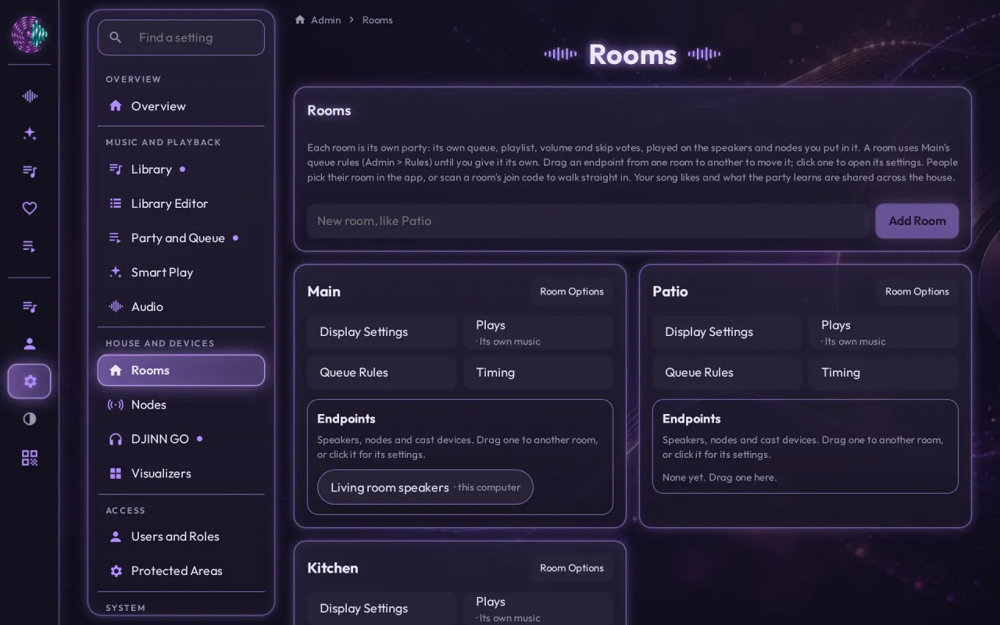
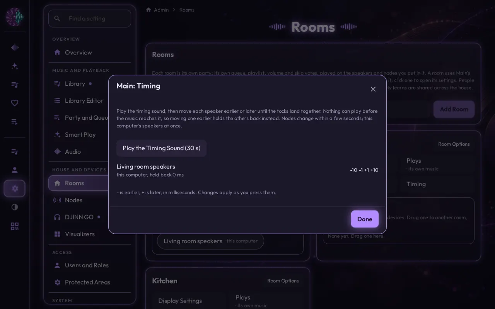

# Rooms

With rooms, one DJINN runs several parties at once: music in the living room,
something calmer on the patio, and the kids' room doing its own thing. Each
room has its own queue, playlist, volume and skip votes, played on the
speakers, [nodes](nodes.md) and cast devices you put in it.

Every DJINN starts with one room, **Main**. If you never add another, nothing
about rooms shows up anywhere.

## Making rooms

**Admin > Rooms** shows a card for each room. Type a name ("Patio") and tap
**Add Room**.

Each room's card lists its **Endpoints**: the speakers on this computer, nodes
and cast devices in it. **Drag** an endpoint from one room to another to move
it, or click it to open its settings. Cast devices DJINN has found that aren't
in a room yet are listed under **Cast devices not in a room**; drag one into a
room to put it there (**Search Again** looks for more).

The buttons on a room's card open a window each:

- **Plays:** what this room plays (see below).
- **Queue Rules:** the room's own limits.
- **Timing:** lining up the room's speakers.
- **Display Settings:** what the room's screens show.
- **Room Options:** rename or delete it. Deleting a room moves its speakers,
  nodes, people and queued songs to Main. Main can't be deleted.

## What a room plays

In **Plays**, a room either plays **Its own music** or plays **Along with**
another room, in step, like linked speakers. Rooms playing along share one
party: one queue, one song at a time, heard in both places. (A room can only
play along with a room that plays its own music, so links never chain.)

A room with its own music can also follow Main while it's quiet: **When
nothing's queued here, play along with Main**. The room then plays Main's
music until someone asks for a song there, and **A request here takes over**
either **Right away** or **When Main's song ends**. Meanwhile the room's
screens show Main's song. These save as you change them.

## Queue rules

**Queue Rules** sets the room's own **Most songs in the queue**, **Songs each
person can have queued** and **Votes needed to skip a song**. A room uses
Main's rules (**Admin > Party and Queue**) until it has its own. **Save and
Apply**.

## Timing

Speakers in one room should sound like one speaker. **Timing** lists every
speaker in the room: this computer's outputs and each node's speakers,
including rooms playing along with it.

1. Tap **Play the Timing Sound (30 s)**. A soft ticking plays in the room, only
   while nothing else is playing there.
2. Walk around and listen. Press **-** to move a speaker earlier or **+** to
   move it later, in milliseconds, until the tocks land together. Changes
   apply as you press them; nodes follow within a few seconds.

Nothing can play before the music reaches it, so moving one speaker earlier
than the rest holds the others back instead (they show "held back").

## Display settings

**Display Settings** chooses what **Every Screen in This Room** shows: the
node status page, nothing, or pages tried in order, like lyrics when the song
has timed lyrics, else the visualizer, else the TV page. A node can choose its
own instead. See [Screens and visualizers](screens-and-visualizers.md).

**Open This Room's Pages** has links to the room's TV page, lyrics page and
join code.

## People and rooms

- Everyone is in one room at a time. With two or more rooms, a **room picker**
  shows on the Playing and Queue tabs; tapping another room moves you there.
- Each room has its own join QR code (on its TV page, and under Display
  Settings). Scanning it puts a phone straight into that room.
- You can only ask for songs in the room you're in. DJINN GO's **Send to the
  Party** goes to your room.
- What you like, and what [smart play](smart-play.md) learns, are shared
  across the whole house.
- The [party schedule](smart-play.md#party-schedule) is set per room.
- **End Party** stops every room.

## Casting in a room

A cast device in a room plays that room's music. Click it to **Cast the
Music**, **Cast the TV Page** (for a TV), set its **Volume**, **Stop Casting**,
or **Remove from** the room. See [Casting and Play here](casting-and-tv.md).
