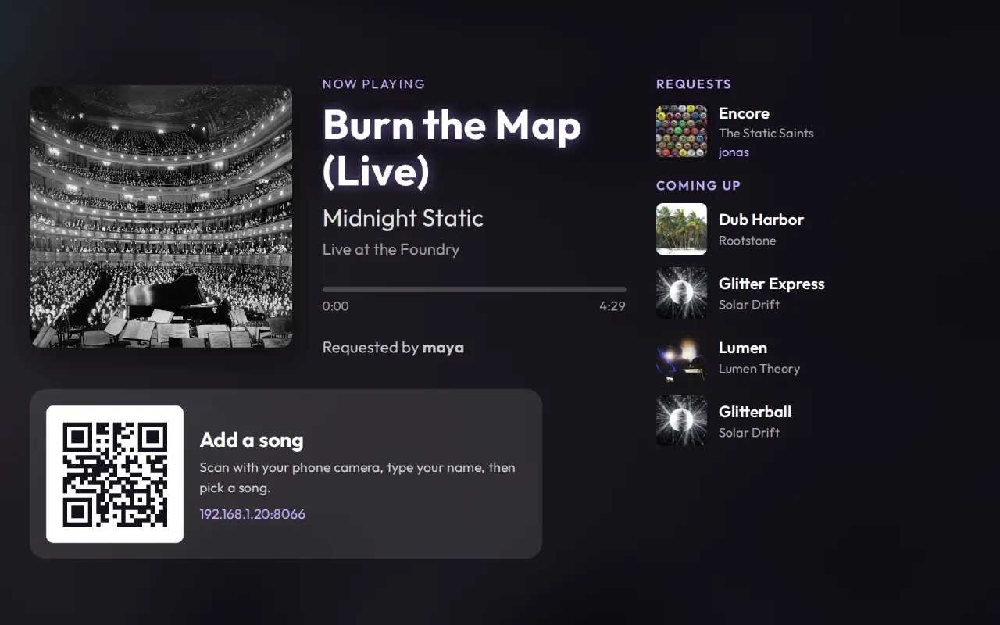
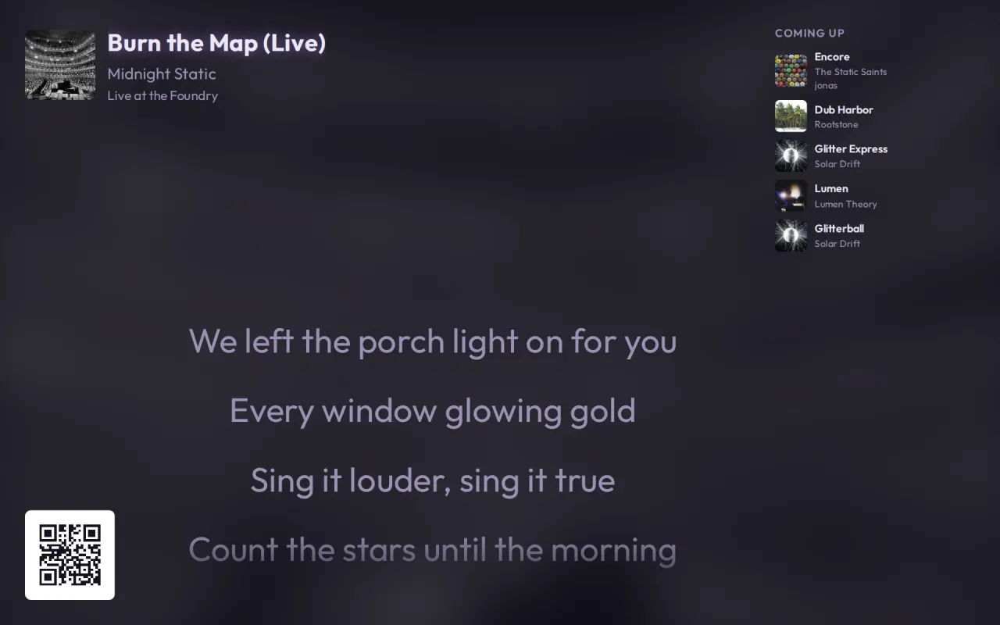
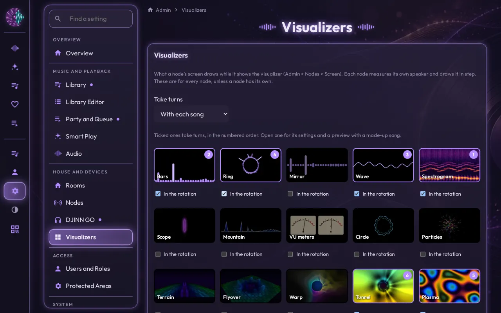

# Screens and visualizers

DJINN has three full-screen pages for a TV, projector, tablet or spare
monitor: the **TV page**, the **lyrics page** and the **visualizer**. None of
them needs a sign-in, so any browser on your network can show them.

## The TV page

What's playing (big cover, title and artist, and who asked for it), the
request queue, what the auto mix plays next, and the QR code for joining
("Scan the code to start the music").

- On by default; turn it off under **Admin > Party and Queue > TV page**.
- Open `/tv` on the screen's browser, for example
  `http://djinn.local:8066/tv`, or use the tray icon's **Open TV page** on this
  computer, or the **TV display** button on the Playing tab.
- On a Chromecast or Google TV, use **Show on TV** in
  [casting](casting-and-tv.md).
- **Full Screen** hides the browser around it.
- The page is silent unless you turn on **Admin > Party and Queue > Sound on
  the TV page**; then **Play Sound Here** on the page plays the party through
  the TV's browser. Anyone who can open the page can listen. Casting has its
  own sound and doesn't need this.
- With [artist slideshows](your-library.md#artist-photos-and-bios) on, the
  background shows pictures of the artist playing, with credits.
- In a house with rooms, `/tv?room=2` shows room 2, and its QR code puts
  phones in that room. **Admin > Rooms > Display Settings > Open This Room's
  Pages** has each room's links.

## The lyrics page

Full-screen lyrics at `/lyrics`, lit line by line as they're sung, for a
karaoke-ish screen at the party. On by default; turn it off under **Admin >
Library > Online Info > Lyrics > Lyrics page**. Songs without timed lyrics
show "No timed lyrics for this song." If the words run ahead of or behind the
music on a particular screen, **Earlier** and **Later** shift them for that
screen. See [Lyrics](lyrics.md).

## The visualizer

**Visualizer** on the Playing tab opens a visualizer drawn from the room's own
speakers, in step with what you hear, with the song and what's coming up.
It switches to the TV page when there's nothing to draw. It uses the same
styles as the screens on nodes, below.

**Show Lyrics** (move the mouse to see the buttons) puts the song's timed
lyrics in a box on the left, over the visual; a song with no timed lyrics
shows no box. The screen remembers the choice. To set it up once, for a
screen plugged in here, open the visualizer's address with `?lyrics=side`
on the end, for example `http://<server>:8066/visualizer?lyrics=side`.

### Styles

**Admin > Visualizers** sets the styles for every screen in the house:

- **Bars:** a bar for each part of the sound, bass on the left.
- **Ring:** the bars around a circle that kicks on each beat.
- **Mirror:** bars growing up and down from the middle.
- **Wave:** the sound wave itself, across the screen.
- **Spectrogram:** the song drawn as it plays: time across, pitch up,
  loudness as color.
- **Scope:** left against right: a line for mono, a cloud for wide stereo.
- **Mountain:** the spectrum as a lit range of hills with its reflection.
- **VU meters:** two needle meters, left and right, like an old amplifier.
- **Circle:** the wave wrapped around a ring that swells with the bass.
- **Particles:** sparks thrown out from the middle, a burst on every beat.
- **Terrain:** a checkerboard of glowing pillars, bass in the middle, treble
  at the edges.
- **Flyover:** the same pillars seen from a helicopter circling slowly.
- **Warp, Tunnel, Plasma, Kaleidoscope, Nebula, Stars:** drawn on the
  graphics chip. A box that can't keep up skips them and moves on to the
  next.

Tick the ones you want **In the rotation**; they take turns in the numbered
order. **Take
turns** chooses when the screen moves to the next: **With each song**,
**Every few seconds**, or **Never (only the first)**. Open a style for its
settings and a preview with a made-up song: its **Colors** (the app's,
your own, a rainbow, or an RGB rotation), how strongly it reacts, and for bar
styles the number of bars, line thickness and rounded bars. **Back to the
defaults** undoes your changes. **Earlier** and **Later** move a style up or
down in the rotation.

## Screens on nodes

A [node](nodes.md) with a screen plugged in (for example a box installed with
**Install DJINN with a screen**) shows the room's pages on it by itself. What
it shows:

- **What the room says:** the room's choice, under **Admin > Rooms > Display
  Settings**. This is the default.
- **Lyrics, visualizer or TV page, in an order:** the screen shows the first
  of these that can show now, and switches as songs change. For example
  lyrics while the song has timed lyrics, else the visualizer, else the TV
  page. The TV page always works.
- **This node's status**, or **Nothing (blank screen)**.

Set it for each node in its settings (**Speaker and Screen**), on the node's
own page, or from the node's tray icon (**Screen shows**). A screen already on
changes within a few seconds.

A node draws its visualizer from its own speaker, so it's always in step with
what that room hears. A node can also have its own visualizer styles instead
of the house's.

If Windows' display scaling isn't 100%, the screen pages show a warning for a
while, since the page may not fit the screen.
