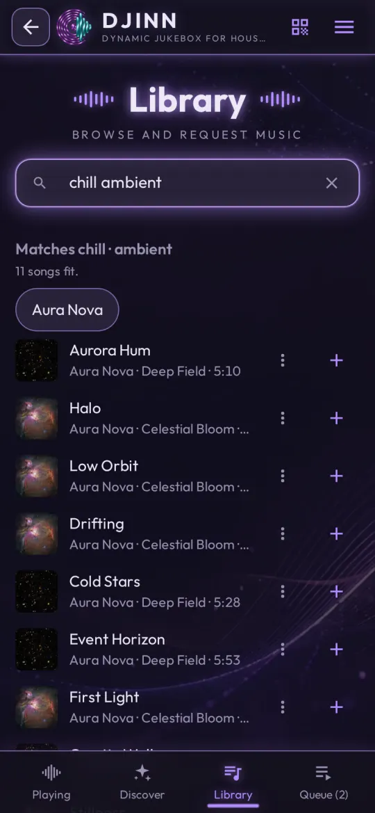
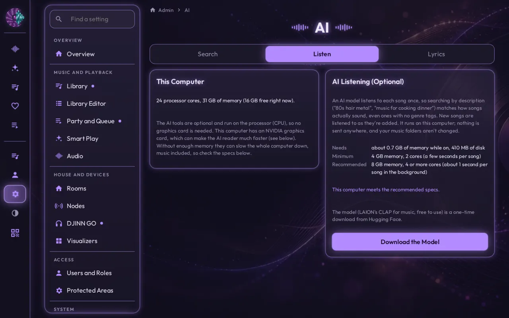
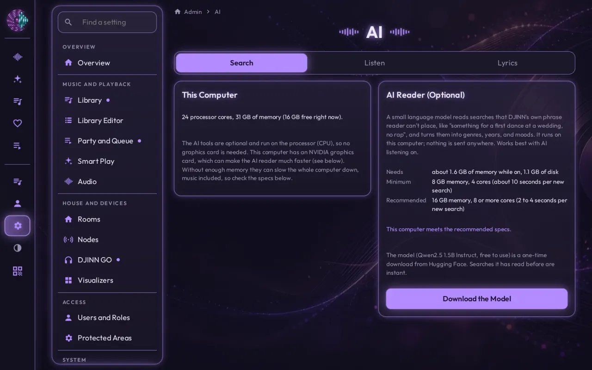

# Search and AI

## Searching

The **Library** tab searches as you type: artists, albums and songs by name.
You can also browse artists, albums, songs and genres, sort by name or year,
and jump to a letter (or year) with the strip beside long lists.

## Searching by description

You can also describe what you want: "80s hair metal", "chill house",
"upbeat like KREAM". DJINN shows the songs that fit under **Matches**, with
what it understood (like "1980s · hair metal"). If it couldn't place some
words, it says "Not sure about..." with those words. Under the matches,
**Save as playlist** keeps them and, for admins, **Play as the auto mix**
starts them playing. See [Playlists and radio](playlists-and-radio.md).

Descriptions work from genres, years and how songs sound, so they get better
when DJINN knows more about your music: tags in your files, genres from
MusicBrainz (see [Your library](your-library.md)), and the AI tools below.

## Searching lyrics

Type two or more words from a song's lyrics, and songs with those words show
under **Songs with these words**. It searches every song DJINN has lyrics for
(see [Lyrics](lyrics.md)).

## Search history

DJINN keeps what people searched for (one entry per search, not every
letter), so you can see what guests looked for and didn't find. See
[Stats and history](stats-and-history.md).

## The AI tools (optional)

**Admin > AI** has optional AI models, on three tabs: **Search** (the AI
reader), **Listen** (AI listening) and **Lyrics** (making lyrics by
listening, see [Lyrics](lyrics.md#ai-lyrics)). The first two are below. Both run on this computer; nothing
is sent anywhere, and your music folders aren't changed. Each is a one-time
download, and the page shows this computer's processor and memory so you can
judge whether it can keep up. Without enough memory they can slow the whole
computer down, music included.

### AI listening

An AI model (LAION's CLAP for music) listens to each song once, so
descriptions match how songs actually sound, even songs with no genre tags.
New songs are listened to as they're added.

1. On the **Listen** tab, tap **Download the Model**.
2. Switch on **Listen to songs with AI**. The page shows how many songs it has
   listened to.

Options:

- **Listening speed:** Gentle (one song at a time, lightest on the computer),
  Normal, or Fast (uses half the processor).
- **Give songs with no genres the ones the AI hears:** fills in genres for
  untagged songs, which helps genre pages, radio and smart play.
- **Stop for Now** pauses it; it carries on when DJINN restarts or new music
  arrives. **Remove the Model** deletes the download.
- It runs in the background when
  [heavy work](your-library.md#when-heavy-work-runs) is allowed to.

What the AI hears in a song shows in its ⋯ menu under **Sounds like**, and
puts the song on those genre pages too. If one is wrong, an admin can tap the
**×** beside it to take it off that song (Undo puts it back). It stays off
when the AI listens again, and other songs keep the genre.

### AI reader

A small language model (Qwen2.5 1.5B Instruct) reads searches DJINN's own
phrase reader can't place, like "something for a first dance at a wedding, no
rap", and turns them into genres, years and moods. It works best with AI
listening on.

1. On the **Search** tab, tap **Download the Model**.
2. Switch on **Read searches with AI**.
3. Choose who it **reads searches for**: everyone (guests too), signed-in
   users, or admins only.

When a search has words DJINN didn't understand, it asks the AI reader once
you stop typing. Matches it found are marked **read by AI**. A new search takes
about 2 to 10 seconds on the processor; searches it has read before are
instant.

### NVIDIA graphics cards

If this computer has an NVIDIA graphics card, the AI reader can use it: each
new search takes about 0.3 seconds. Tap **Download the GPU Pack** (it comes
from GitHub with NVIDIA's CUDA libraries, so nothing else needs installing),
then switch on **Use the graphics card**. If the card ever fails, DJINN goes
back to the processor by itself.

The GPU pack needs an RTX 30-series or newer card. Older cards use the
processor.
