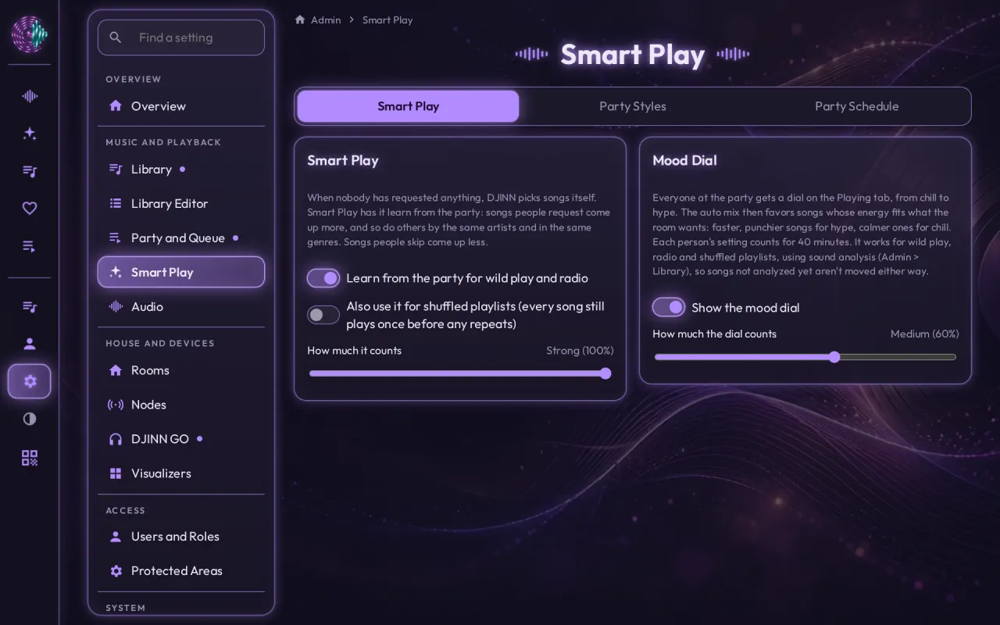
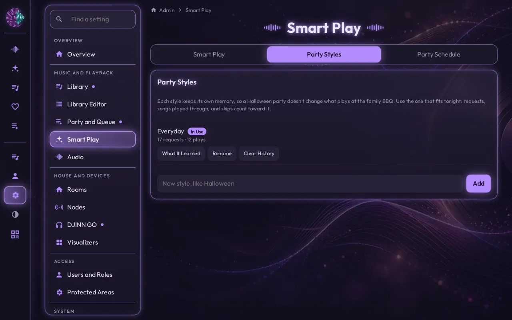
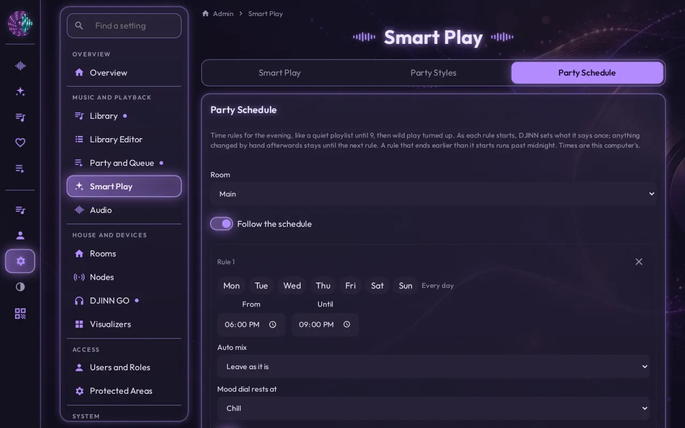

# Smart play, the mood dial and the party schedule

When nobody has requested anything, DJINN picks songs itself (the auto mix:
a playlist, wild play or radio; see [Playlists and radio](playlists-and-radio.md)).
**Admin > Smart Play** shapes how it picks. It has three tabs: **Smart Play**,
**Party Styles** and **Party Schedule**.

## Learning from the party

Smart play lets the auto mix learn from the party. Songs people request come
up more, and so do other songs by the same artists and in the same genres.
Songs people send away come up less.

What counts against a song: someone choosing **Skip and play less like this**,
or the room's skip votes sending it away (which counts double). A plain skip
counts for nothing, since it may only mean someone wanted the next song
sooner. Plays and "play less" skips on DJINN GO count too.

On the **Smart Play** tab:

- **Learn from the party for wild play and radio:** on by default. Off, wild
  play is plain random and radio goes by sound alone.
- **Also use it for shuffled playlists:** off by default. When on, songs the
  party likes tend to come earlier in each shuffle, and ones it avoids later.
  Every song still plays once before any repeats, so nothing is left out of
  your playlist.
- **How much it counts:** from Off (0%) to Strong (100%, the default). Lower
  it if the mix keeps leaning on the same favorites.

## The mood dial

Everyone at the party gets a dial on the Playing tab, from **Chill** through
**Easy**, **In between** and **Lively** to **Hype**. The auto mix then favors
songs whose energy fits what the room wants: faster, punchier songs for hype,
calmer ones for chill.

- Each person's setting counts for 40 minutes, then fades out.
- The dial shows what the party as a whole wants, and how many people are
  nudging.
- It works for wild play, radio and shuffled playlists. A playlist playing in
  order keeps its order.
- It uses [sound analysis](your-library.md#sound-analysis) to know each
  song's energy, so songs not analyzed yet aren't moved either way.

On the **Smart Play** tab: **Show the mood dial** (on by default) and **How
much the dial counts** (60% by default). The party schedule can also set
where the dial rests when nobody is nudging it.

## Party styles

A Halloween party and a family BBQ want different music. On the **Party
Styles** tab, each style keeps its own memory, so one doesn't change what
plays at the other.

One style is in use at a time, marked **In Use**. Requests, songs played
through, and skips count toward it. The first style, **Everyday**, holds
everything DJINN learned before styles existed.

For each style you can:

- **Use Now:** make it the one in use, for tonight's party. The mix changes
  right away.
- **What It Learned:** the most favored and most avoided songs, artists and
  genres. The number next to each is how much more (or less) often it comes
  up: 2.0x is twice as often, 0.5x half as often. Artists and genres count for
  less than a song itself.
- **Rename** it.
- **Clear History:** forget what that style learned and start fresh. The
  request log keeps its history, and recently played songs still won't repeat
  too soon.
- **Delete** it. The style in use can't be deleted; use another one first.

To add a style, type a name at the bottom ("Halloween") and tap **Add**.

## Party schedule

The **Party Schedule** tab sets time rules for the evening, like a quiet
playlist until 9, then wild play turned up.

1. Pick the **Room** (when you have more than one; each room has its own
   schedule) and tick **Follow the schedule**.
2. **Add a Rule**, or **Start from an Example Evening** and change it.
3. For each rule choose the **Days** (or **Every day**), **From** and
   **Until**, and what it does:
   - **Auto mix:** **Leave as it is**, **Wild play (the whole library)**, or
     a playlist.
   - **Mood dial rests at:** Chill, Easy, the middle, Lively or Hype.
   - **Set the volume**, if you want it to.
4. **Save**.

As each rule starts, DJINN sets what it says once. Anything changed by hand
afterwards stays until the next rule starts. A rule that ends earlier than it
starts runs past midnight (from 22:00 until 02:00). Times are this computer's.
DJINN remembers which rule it last applied, so a restart doesn't apply it
again; changing a rule applies it again.

## Ending the party

**End Party** on the Playing tab (admins) stops the music in every room,
empties every request queue and switches the auto mix off. The song that was
playing isn't counted as skipped.

## Tips

- It learns as the party goes, so a new style starts out neutral and gets
  better over a few parties.
- What it learned is reread every couple of minutes while music plays.
  Switching styles or changing a setting takes effect right away.
- Radio also adjusts within a session on its own, whatever these settings are.
- The **Coming up** list on the Playing tab shows the next few songs the auto
  mix has planned. A request that bumps one puts it back at the front, and a
  big move of the mood dial plans again.
