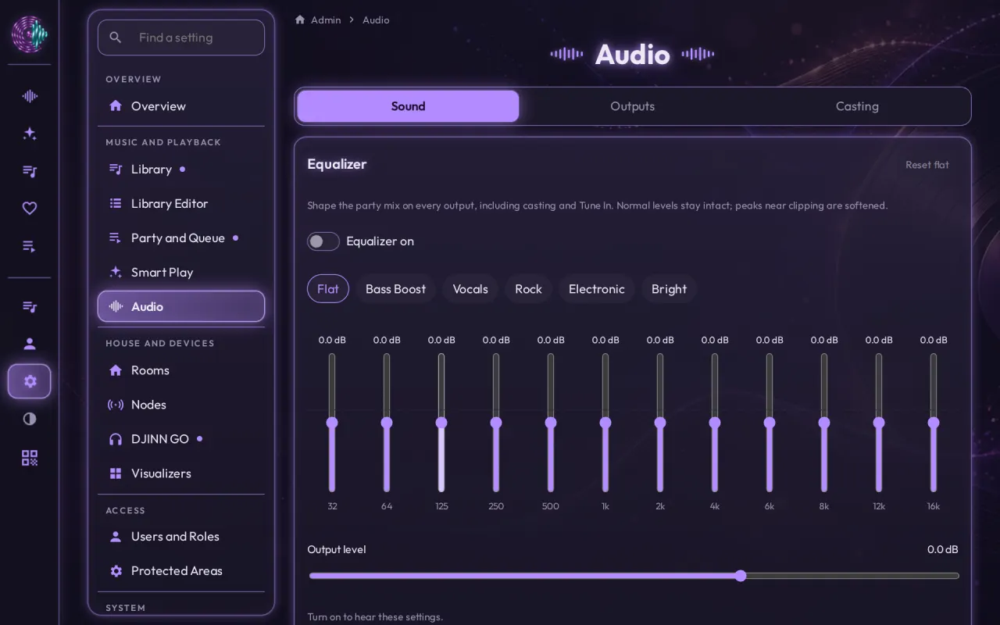
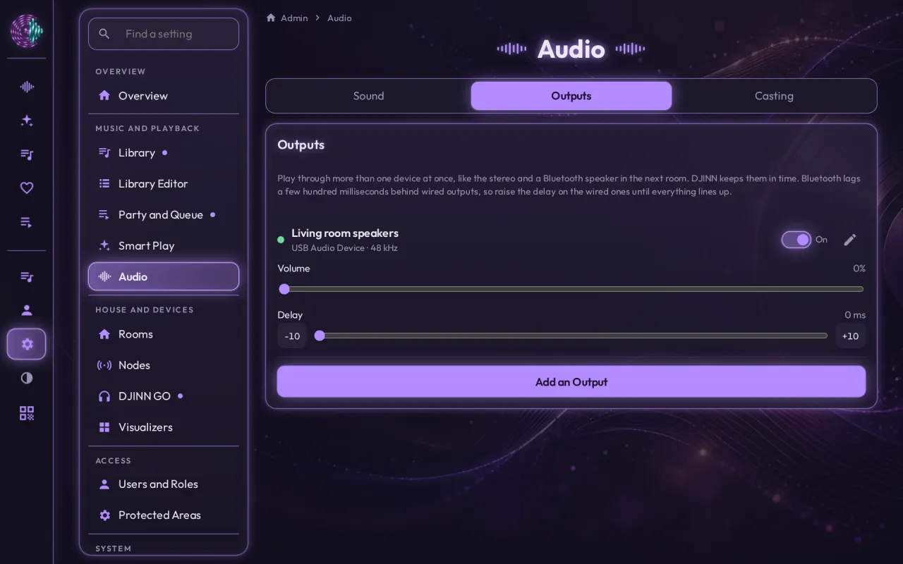

# Speakers and sound

**Admin > Audio** has everything about how DJINN sounds, in three tabs:
**Sound** (equalizer, crossfade and volume leveling), **Outputs** (the
speakers on this computer) and **Casting** (Chromecast, smart TVs and Sonos;
see [Casting and Play here](casting-and-tv.md)). Volume, play, pause and skip
are on the Playing tab.

Speakers in other rooms, on other computers, are [nodes](nodes.md). Which
speaker plays which room is set under [Rooms](rooms.md).

## Equalizer

The equalizer on the **Sound** tab shapes the party mix on every output,
including casting and Tune In. It has 12 bands and presets: **Flat**, **Bass
Boost**, **Vocals**, **Rock**, **Electronic** and **Bright**, or **Custom**
when you move the bands yourself. **Output level** lowers everything if a
boost makes it too loud. Normal levels stay intact; peaks near clipping are
softened. Changes apply while music plays. **Reset flat** undoes it all.

Each node has its own equalizer too (see [Nodes](nodes.md)), and DJINN GO has
one for each person's own listening.

## Crossfade

**Blend songs into each other:** 0 to 12 seconds, or **Off (gapless)**, the
default. Songs from the same album always join without a gap, so live albums
and DJ mixes flow as recorded. Skipping a song fades too.

## Volume leveling (ReplayGain)

Keeps songs at an even loudness, so a quiet old track isn't followed by a
blast.

- **Off:** songs play as loud as they were made.
- **Even out every song:** best for parties and shuffled playlists.
- **Even out albums:** quiet and loud songs on an album keep their difference.
  Good for playing whole albums.

DJINN uses ReplayGain tags when a file has them. For files without, it
measures each song once during [sound analysis](your-library.md#sound-analysis)
(**Admin > Library > Online Info**) and keeps the result in its own database;
your files aren't changed. The card shows how many songs are measured. Songs
not measured yet, or all of them while sound analysis is off, play unchanged.

**Boost:** leveled songs play quieter than most modern recordings. Raise it if
everything sounds too soft; songs are never pushed into clipping.

Changes apply from the next song.

## Outputs: several speakers at once

The **Outputs** tab lists the speakers on this computer that DJINN plays
through. DJINN can play through more than one at once, like the stereo and a
Bluetooth speaker in the next room, and keeps them in time.

- **Add an Output** lists the devices this computer can play through. A
  Bluetooth speaker shows up once it's paired and connected to the computer.
  On Linux, PipeWire and PulseAudio devices are listed, Bluetooth included.
- Each output has an **On** switch, its own **Volume**, a **Delay**, and can
  be renamed or removed.
- With more than one playing, one is marked **Clock**: the others keep time
  with it. Each of the others shows **In sync**, or how many milliseconds it
  is behind or ahead while it catches up. DJINN speeds them up or slows them
  down by tiny amounts you can't hear, so they never drift apart over a long
  night.
- **Lining them up:** Bluetooth lags a few hundred milliseconds behind wired
  outputs. Raise the **Delay** on the wired ones (the -10 ms and +10 ms
  buttons help) until everything sounds together. With rooms, the **Timing**
  window plays a ticking sound to make this easy; see
  [Rooms](rooms.md#timing).
- An output that's unplugged or busy shows **Not connected** with the
  reason.

If no output works at all, the Playing tab shows "Audio output problem". See
[Troubleshooting](troubleshooting.md).

## Gapless and formats

DJINN plays MP3, FLAC, AAC and M4A, Ogg Vorbis and WAV. Files in formats it
can't play (Opus, WMA, AIFF, APE and others) are listed under
[Library problems](library-problems.md) so you know they were skipped. Apple
Lossless (ALAC) songs in `.m4a` files don't play either; they show up there
as files that won't play.

Songs from the same album play straight into each other with no gap, even
when they have to be converted to the speaker's sample rate.
