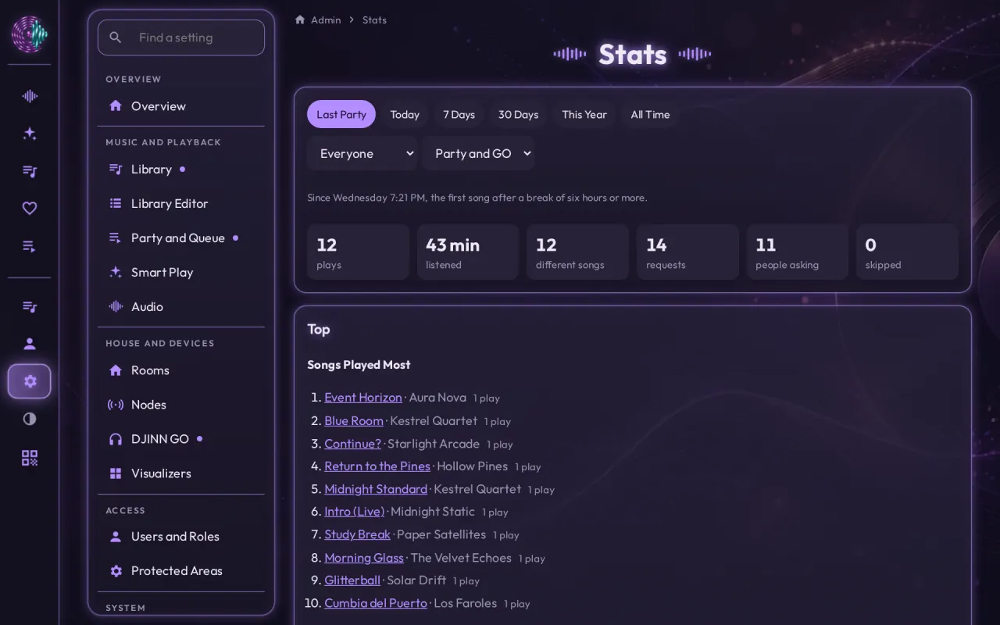
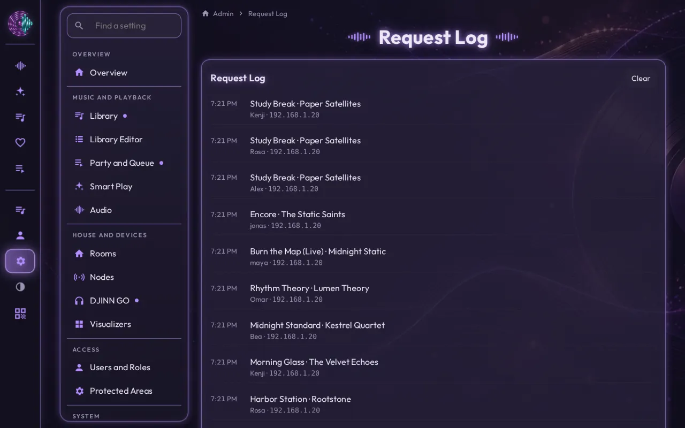

# Stats and history

**Admin > Stats** shows what got played, asked for and skipped, and what
people searched for. Its **Request Log** tab lists every request.

## Stats

Choose what to look at:

- **Time:** **Last Party**, **Today**, **7 Days**, **30 Days**, **This Year**
  or **All Time**. The last party starts at the first song after a break of
  six hours or more.
- **Whose:** **Everyone**, or one person.
- **Where:** **Party and GO**, **Party only** or **GO only**.

You then see plays, time listened, different songs, requests, how many
people asked, and how many songs were skipped, with:

- **Songs Played Most**, **Asked for Most** and top **Artists**.
- **Who Asked Most** and **Skipped Most**.
- **When:** plays by hour of the day and by day of the week, and when the
  party is busiest (this computer's time).

**Download the Lists as a Spreadsheet** saves them.

A play counts once enough of the song was heard (50% by default, set under
**Admin > Library > Library Settings**).

### Clearing history

**Clear This History** forgets the plays and requests in the view you've
chosen (its time, person and where). What [smart play](smart-play.md) learned
from them goes too, and top songs on artist pages count again from what's
left. It says how many party plays, GO plays and requests it removes before
you confirm. To forget everything at once, see
[System](system.md#clear-and-reset).

## Searches

The **Searches** card shows what people searched for in the last 90 days
(typing is counted as one search, not every letter):

- **Found Nothing:** searches that found nothing: songs people want that the
  library lacks.
- **All Searches:** what was searched most, with how many people, how many
  found something, and how many then asked for a song.

**Keep a history of searches** is on by default. **Clear the Search History**
empties it.

## The wishlist

Under search results, **Not in the library?** > **Ask for it** lets people
ask for a song you don't have. The **Wishlist** card lists them:

- **Wanted:** what people asked for, and how many asked.
- **Got:** when a library check adds a wished-for song, it moves here by
  itself. **Got It** moves one by hand.
- **Ignored:** wishes you've set aside with **Ignore**.

**Let everyone ask for songs that are not in the library** is off by
default, so only admins see the button. Turn it on to let guests and
listeners ask too. The Android app has it under search results as well.

## The request log

**Admin > Stats > Request Log** lists every request with who made it, when and from
which device. **Clear** empties the log; artist pages keep counting their top
songs.

## On the Overview

**Admin > Overview** has an **All-time Listening** card (party and DJINN GO
together): time listened, plays, different songs, requests and from how many
people, skips, the most played song and artist, the most requested song, and
the busiest time.

## Your Year (DJINN GO)

Each listener can see their own year on DJINN GO. See
[DJINN GO](djinn-go.md#listening).
