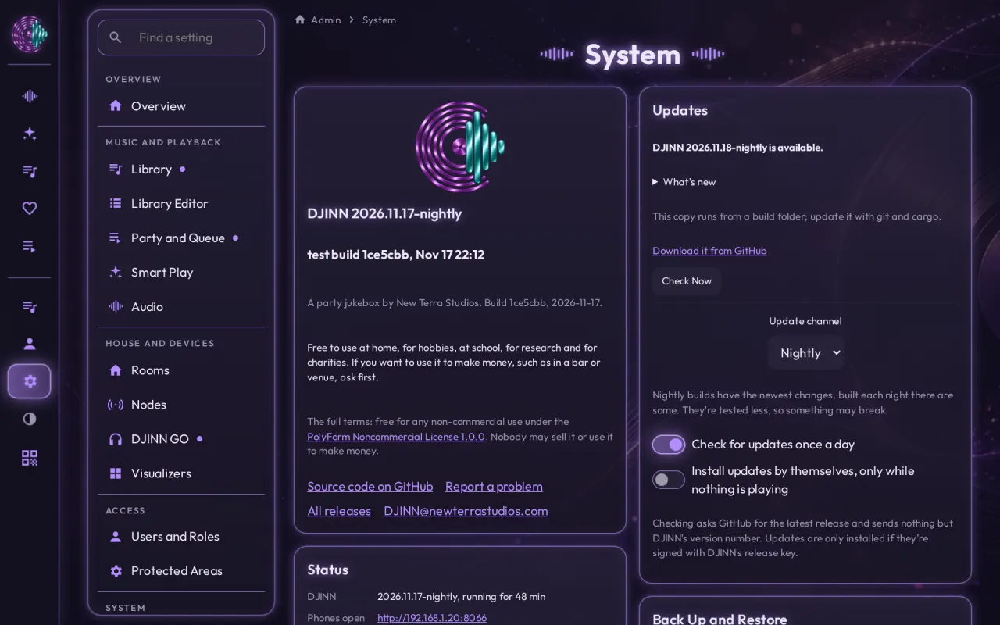
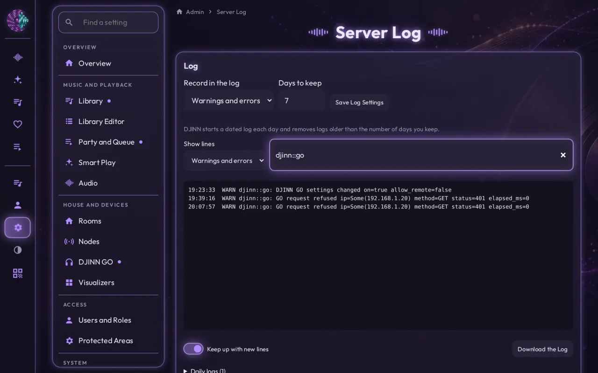

# System tools

**Admin > System** shows how DJINN is doing and holds the tools for looking
after it: the version, **Status**, **Background**, **Language**, **Updates**,
**Back Up and Restore**, **Clear and Reset**, and the credits.

**Admin > Overview** is the health dashboard: what's playing and on which
speakers, the library, this computer's processor, memory, disk and network,
and upkeep (music folders, problems, the nightly check, the last backup and
updates), each marked **Fine**, **Worth a look** or **Wrong**. On Windows it
warns when the network is set to Public, which keeps phones out.

## Status

- **Phones open:** the addresses phones use to reach DJINN. If a phone can't
  connect, check it's opening one of these, on the same Wi-Fi.
- **Library, music, speakers, casting and AI:** what's loaded and playing,
  with any speaker or cast that has a problem in red.
- **Storage:** how much room the database, artwork and AI models take, and
  the folder they're in.
- **Restart DJINN** stops the music for a few seconds and carries on where
  it was. **Quit DJINN** stops it until someone starts it again on its
  computer.

**Server ports** lets an admin change the party and DJINN GO ports. Pick two
different available ports and save, then restart DJINN to apply them. If
you connect directly to the party address, the Admin page follows the new
party port after restart. Update any router forwarding or reverse proxy
to use the new port. These saved ports override `config.toml`.

## Background

The picture behind every page of the party app, signed in or not. **Use My
Own Picture** (at least 800 by 450 pixels, up to 12 MB; dark pictures read
best), **How strongly it shows**, or **Remove My Picture**. The TV and lyrics
pages keep their own.

## Language

**Default language** sets what DJINN shows everywhere: the party app, the
admin pages, DJINN GO and the Android app. **Each device's own language** (the
default) lets every phone and browser use its own. Anyone can still pick
their own language on their account page. DJINN speaks English, Spanish and
German.

## Updates

Checking for and installing new versions; see [Updates](updates.md).

## Back up and restore

Saving everything DJINN knows to one file; see
[Back up and restore](backup-and-restore.md).

## Server log

**Admin > Server Log** shows the latest lines DJINN has written since it started, newest at the bottom,
with times as the DJINN computer's clock shows them. Set **Record in the
log** to full tracing, warnings and errors, or errors only. This changes
what DJINN records immediately. **Show lines** filters what you see without
changing what is recorded. Search for a word in the recent lines.

DJINN writes one dated file per day and keeps seven days by default. Change
**Days to keep** from 1 to 365. Use **Download the Log** for today's file,
or pick a date under **Daily logs** for an earlier one. A log can include
song names and the addresses of devices on your network.

## Clear and reset

**Clear and Reset** has these. Each asks first and can't be undone, so
download a backup before using one (there's a link under each button).

- **Clear the Queue:** removes every song waiting to play.
- **Undo All Tag Corrections:** every song, album and artist goes back to
  what its files say.
- **Remove All Imported Lyrics:** takes back every lyric that came from an
  imported zip. Lyrics from song files, tags and LRCLIB stay. See
  [Lyrics](lyrics.md).
- **Analyze All Songs Again:** measures how every song sounds and how loud
  it is again, in the background.
- **Let the AI Listen Again:** the AI listens to every song again.
- **Clear Play and Request History:** forgets every play and request, and
  what the auto mix learned, for every party style.
- **Reset Settings:** puts the rules, sound, smart play, AI and update
  options back to their defaults. Accounts, music folders, playlists,
  speakers, casts and online service details stay.
- **Reset DJINN Completely:** puts DJINN back the way it was when first
  installed. Accounts, settings, playlists, history, speakers, casts, tag
  corrections, artwork and analysis all go; your music files stay as they
  are, and downloaded AI models stay so they don't download again. It asks
  you to type RESET first. Afterwards DJINN opens its setup page on its
  computer to create the admin account again (the setup link is also in the
  log).

Analyzing again, letting the AI listen again, clearing history and both
resets restart DJINN when they're done; apart from the complete reset, the
music carries on where it was.
