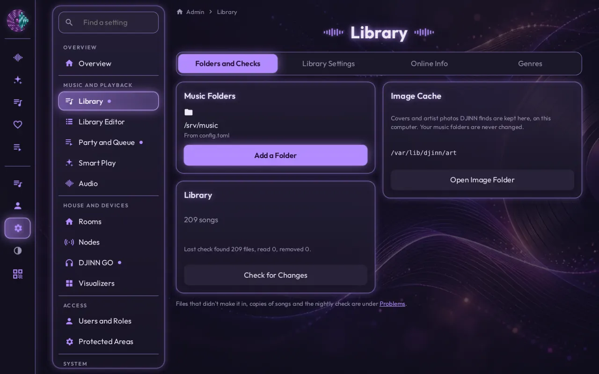
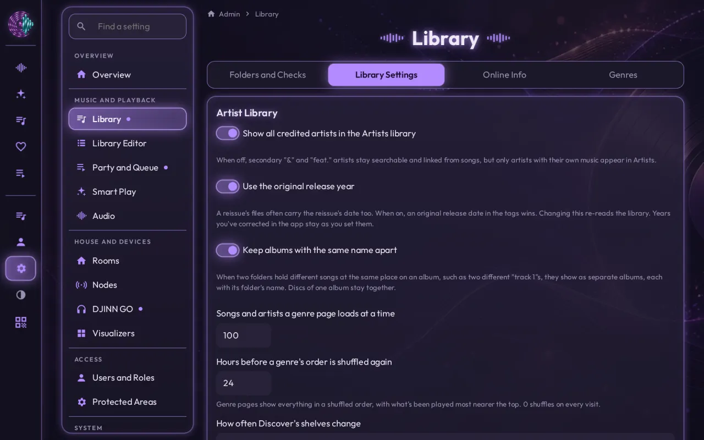
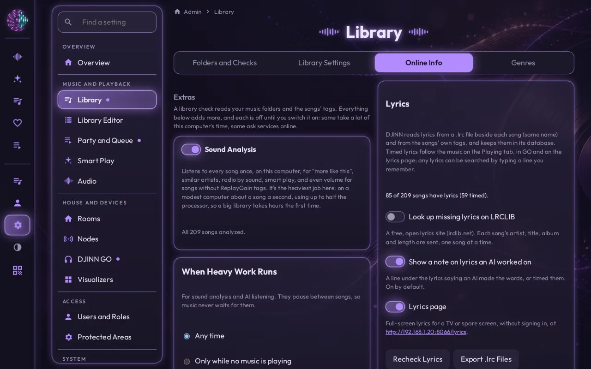
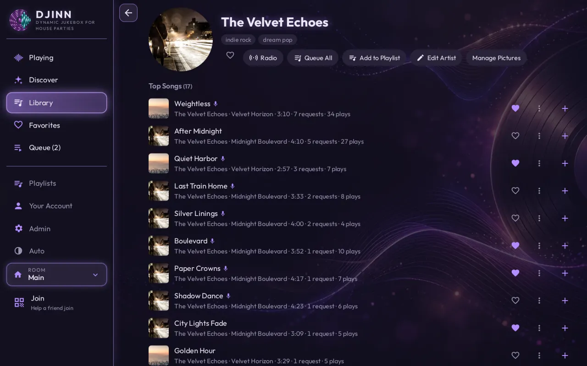
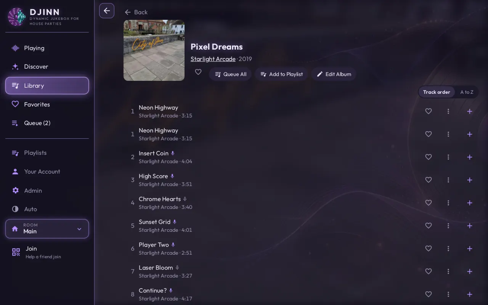
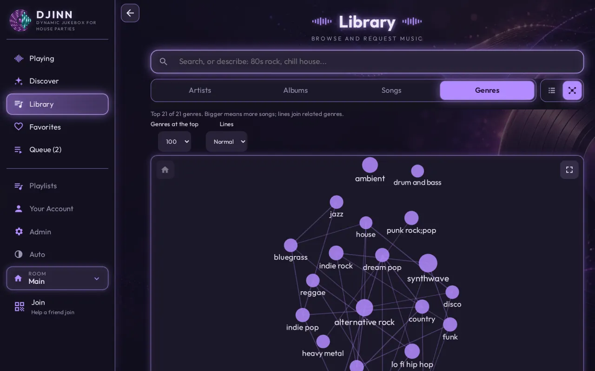
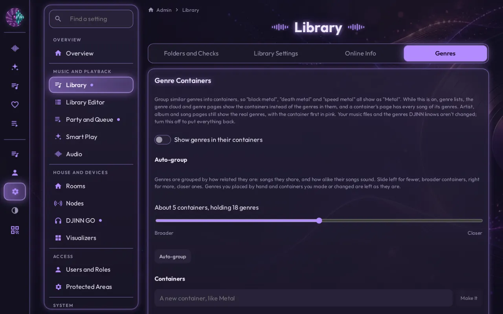

# Your library

DJINN reads MP3, FLAC, AAC/M4A, Ogg Vorbis and WAV files, with their tags and
cover art. A library check only reads: everything DJINN adds (artwork,
measurements, identified details, lyrics) lives in its own folder. The one
place that can change your files is the [Library Editor](library-editor.md),
and only in folders you allow.

**Admin > Library** has four tabs: **Folders and Checks**, **Library
Settings**, **Online Info** and **Genres**. Problems DJINN finds are on their
own page, [Library problems](library-problems.md).

## Music folders

**Admin > Library > Folders and Checks** lists your music folders.

- **Add a Folder** with the folder picker; on Windows it can be on any drive.
  DJINN reads the new folder right away.
- **Remove a folder** (×): its songs disappear from DJINN. The files stay.
- A folder that's unplugged or unreachable shows "Not found right now", and
  its songs aren't treated as missing while it's away.
- Folders listed in the settings file (`config.toml`) are marked as such and
  can only be removed there.
- DJINN watches your folders and picks up new music by itself. To look for
  changes now, use **Check for Changes**. The card says when the last check
  was, with a link to anything it found under Library problems.
- While DJINN works through new music, the top of the Library tab shows
  each step: finding music, reading songs, sorting albums and artists, and
  then sound analysis and AI listening when they're on. Songs can be played as
  soon as they've been read; the later steps carry on in the background.
- **Image Cache:** covers and artist photos DJINN finds are kept on this
  computer. **Open image folder** shows them.

A library check can also run every night: see
[Library problems](library-problems.md#the-nightly-check).

## Library settings

**Admin > Library > Library Settings**:

- **Show all credited artists in the Artists library:** on by default. Off,
  secondary "&" and "feat." artists stay searchable and linked from songs, but
  only artists with their own music appear in Artists.
- **Names that should never be split, one per line:** songs credited to
  "A & B" or "A feat. B" count for each artist. Band names that contain &,
  commas or "x" (like "Earth, Wind & Fire") go here so they stay one artist.
  Saving re-reads the library.
- **Use the original release year** and **Keep albums with the same name
  apart:** see below.
- **A play counts once this much of the song is heard:** 50% by default. For
  the play counts in the library lists. 0 counts every play.
- **Songs and artists a genre page loads at a time** and **Hours before a
  genre's order is shuffled again:** see [Genres](#genres).
- **How often Discover's shelves change:** the Discover tab picks which
  favorites, albums and artists to show; refreshing shows the same ones until
  this long has passed.

## Online info and extras

A library check reads your music folders and the songs' tags, and that's all
DJINN needs to play them. Everything on **Admin > Library > Online Info** is
an extra, each off until you switch it on (lyrics lookups excepted), so a
modest computer isn't kept busy with work you don't want, and nothing is sent
online unless you ask.

### Sound analysis

Listens to every song once, on the DJINN computer, for "more like this",
similar artists, radio by sound, smart play, the mood dial, and even volume
for songs without ReplayGain tags. It also takes a short fingerprint of each
song, used to find [duplicates](library-problems.md#possible-duplicates).
It's the heaviest job DJINN does: on a modest computer about a song a second,
using up to half the processor, so a big library takes hours the first time.
After that, only new songs. The card shows how many songs are done.

### When heavy work runs

Sound analysis, AI listening and AI lyrics can run **Any time**, **Only while
no music is playing**, or **Only from** one hour **until** another (this
computer's time; from 22:00 until 06:00 runs overnight). They pause between
songs, so they stop within seconds when music starts or the hours end, and
carry on where they left off. The progress at the top of the Library tab says
when they're waiting and why. **End Party** quiets the house so they can run.

### Artist photos and bios

**Artist Photos and Bios:** from Deezer, Wikimedia Commons (with credit) and
Wikipedia. Sends artist names to them after a library check that finds new
artists. Pictures in your own folders always win.

**More pictures** adds a slideshow to artist pages, and to the TV page while
their songs play, each picture with its credit. It needs MusicBrainz (below)
to find the right artist. Each artist's pictures are fetched the first time
they're shown, so the first visit takes a few seconds.

- **Artist Picture Sources:** choose where pictures come from: Deezer,
  Wikipedia (bios), Wikimedia Commons, fanart.tv (needs your free API key),
  TheAudioDB (`123` is the free key), and Unsplash (needs an access key; its
  pictures load straight from Unsplash, so **Allow remote image display**
  must be on).
- **Picture Download Limits:** pictures per artist, MB per artist, the art
  cache's maximum size, the largest image edge, and the smallest picture worth
  taking. Pictures are resized before they're kept.
- **On an artist's page**, admins can **Manage Pictures**: put them in
  slideshow order, remove one, **Find Automatic Pictures Again**, search
  Unsplash, or **Add a Picture** of your own (a file you have the rights to,
  with its photo credit).

### MusicBrainz

Album covers from the Cover Art Archive, album and artist genres, and exact
artist matches (which also finds better photos and bios). MusicBrainz needs no
account, but asks apps to say who to contact if something goes wrong: fill in
an email address or website under **Contact**, then switch it on. DJINN asks
MusicBrainz at most once a second, as it requests.

With either lookup on, **Look Up New Artists** does it now and **Recheck All**
redoes every artist. Automatic lookups after a library check only cover
artists and albums not looked up yet.

### Identify songs by sound

Finds the album, year and genres for songs whose tags are missing them, by
how they sound (AcoustID, then MusicBrainz). It only runs when you start it.

1. Fill in the MusicBrainz contact, and an **AcoustID key**: free for
   non-commercial use, register an application at
   [acoustid.org/new-application](https://acoustid.org/new-application) and
   paste its key.
2. Tap **Identify Songs**. DJINN listens for matches in the background.
3. Review what it found. Each match shows what it would fill in and how sure
   it is. Tap **Use** to keep it, or **Use All**.

A match must agree with the title and artist already in the file. What you
keep is stored in DJINN's database; your files aren't changed. Only a
fingerprint of each song (not the audio) goes to AcoustID.

### Spotify and YouTube

- **Spotify Account for Album Lookups** lets the Library Editor's album
  layout look albums up on Spotify too. See
  [Library Editor](library-editor.md#album-layout).
- **YouTube Playlist Links** lets people import YouTube playlists. See
  [Playlists and radio](playlists-and-radio.md#turning-on-youtube-links).

### Lyrics

The **Lyrics** card is here too. See [Lyrics](lyrics.md).

## Album years

A reissue's files often carry the reissue's date. DJINN uses the original
release date when the tags have one, and an album shows the year most of its
songs give. To use the file's own date instead, turn off **Use the original
release year** in **Admin > Library > Library Settings**; that re-reads the library.

## Albums with the same name

Two releases can share a name and artist, like Weezer's Blue and Green albums.
When two folders hold different songs at the same place on an album (two
different "track 1"s), DJINN shows them as separate albums, each with its
folder's name. Discs of one album stay together, whether in folders like `CD1`
or with their own disc numbers, and so does one song in the wrong folder. Likes
and playlists stay with the biggest part. **Keep albums with the same name
apart** in **Admin > Library > Library Settings** turns this off.

## Correct tags

Wrong or missing titles, artists, albums, years and genres can be fixed in
the app (admins only). DJINN keeps the corrections in its own database and
uses them in place of the file's tags, even after the file is read again;
the files themselves aren't changed.

- **One song:** open its menu (⋯) and tap **Edit Tags**.
- **A whole album:** on the album's page, tap **Edit Album** to change the
  album name, album artist, year or genre for all its songs at once.
- **An artist:** on the artist's page, tap **Edit Artist** to fix their
  name on every song and album they're on (their photo and bio stay), or
  set the genres of the songs they lead.
- Genres are separated by commas. Corrected genres take the place of the
  ones looked up online for those songs.
- An artist like "Björk feat. Thom Yorke" is split into its artists, the
  same way as tags from the file.
- A corrected field says **Corrected · use the file's**; tap it to go back
  to what the file says. Emptying a field does the same, and **Use the
  file's tags** undoes every correction.

## Genres

The Library's **Genres** tab lists every genre with its number of songs, or
shows them as a cloud, where bigger means more songs and lines join related
genres.

The cloud opens on your 100 biggest genres. Tap one to center on it, with what's
near it and what's near those; tap it again to open its page, or tap another to
move there. That way every genre can be reached, however small. **Home** goes
back to the top from anywhere, and your back button goes back a step. Drag to
move around, and pinch, scroll or use the buttons to zoom. You can choose how
many genres the top shows (**Fewer**, **Normal**, **More**), and how many
**Lines** to draw.

Each genre's page shows related genres, a row of its artists, a radio button,
and all its songs, loading more as you scroll. They come in a shuffled order
that favors what's been played, by anyone, on the jukebox, GO or a phone app.
The same order stays for a while, so you can come back to it. **Admin > Library >
Library Settings** sets how many load at a time (100 by default) and how many
hours until it's shuffled again (24 by default; 0 shuffles on every visit).

### The genre family tree

**Admin > Genres > Family Tree** shows DJINN's own map of genres, the one it
is learning to use for playing by description, radio and containers. Families
(Rock, Metal, Electronic and so on) open into genres, and genres into styles.
Pick a genre to see its other names, what it grew out of, what it's close to,
what it was a reaction against, and how many of your songs land on it.
**Only genres in my library** hides the rest. Under the tree are your
library's genres the tree doesn't know yet.

**Admin > Genres > Map** draws one family at a time. Each genre sits under the
genre it's a kind of; green lines with arrows run from a genre to what grew out
of it, dotted purple lines join close genres, and dashed red lines point from a
genre to what it was a reaction against. Tags on the right lead into other
families. Tap a circle to open or close a branch (a closed branch carries the
lines of everything in it), and tap a name to light up its lines.

### Genre containers

A big library can have hundreds of genres, many of them close cousins
("black metal", "death metal", "speed metal"). **Genre containers** (off by
default, **Admin > Genres > Containers**) group similar genres under one name,
so they all show as "Metal", without changing anything in your library.

1. Tap **Auto-group**. DJINN works out how genres relate: songs they share,
   and how alike their songs sound (so it works better after
   [sound analysis](your-library.md#sound-analysis)).
2. Slide **How many containers** toward **Broader** for fewer, bigger
   containers, or **Closer** for more, smaller ones.
3. Rename a container, drag genres between containers (or tap one and
   choose **Move Here**), or make your own with **Make It**. Genres you
   place by hand stay put when you Auto-group again.
4. Tick **Show genres in their containers**.

While it's on, the genre list, the cloud and genre pages show containers,
and a song's genres show its container first, in pink. Search by description
still reads the real genres. **Remove Every Container** starts over.
